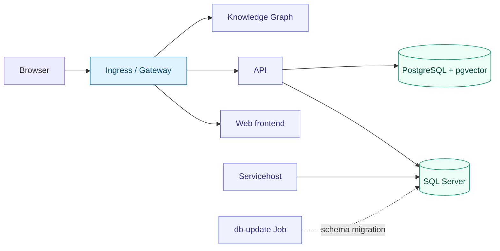

# MEF.DEV · Kubernetes

<p>
  
  
  
</p>

**Install MEF.DEV on Kubernetes — automatically or step by step with Helm.**

Deploy the web frontend, API, Servicehost, Knowledge Graph, SQL Server and PostgreSQL
with pgvector. Microsoft Entra ID is the primary sign-in method. The supplied bundle
adds BPMN Designer and the ProductCatalogAI backend.

## Choose your installation path

| | [A · Script installation](#install-with-bash) | [B · Manual Helm installation](#manual-installation) |
| :--- | :--- | :--- |
| Best suited for | A new installation with one configuration file | Administrators who want to configure and apply every step |
| What you edit | `.local/install.env` | `helm/values/<component>.yaml` and local Secret files |
| How you deploy | One `./install.sh` run | Explicit `helm upgrade --install` commands |
| Entra registration | Created by the script, or an existing prepared registration | Prepared by the administrator |
| Initial MEF account, setup and plugins | Configured by the script for `MEF_SETUP_EMAIL` | Completed in Apps after staging the plugin bundle |
| Access assignment | Script grants the configured Microsoft user access | Administrator enables namespaces and assigns users |
| Azure CLI | Required for the default script path | Not required for the manual browser/Helm path |

Choose **one** path for the initial installation. Both deploy the same Helm charts,
shared storage and applications in `mef-dev`. The script is intended for installations
it owns; it does not take over an independently installed namespace.

**[Requirements](#prerequisites)** · **[Script](#install-with-bash)** ·
**[Manual Helm](#manual-installation)** · **[Ingress / Gateway](#networking)** ·
**[Plugins](#plugin-packages-and-repeat-runs)** · **[Operations](#operations)** ·
**[Troubleshooting](#troubleshooting)**

## Deployment model



```text
k8s/
├── README.md
├── install.sh          # Platform, plugin installation and initial access
├── deployment-packages/ # Plugin manifest and ZIP packages
│   ├── manifest.json
│   ├── BPMN.zip
│   └── ProductCatalogAI.zip
└── helm/
    ├── charts/          # Component Helm charts
    └── values/          # One complete YAML file per component
        ├── api.yaml
        ├── apps.yaml
        ├── …
        ├── secrets/     # Plain Kubernetes Secret templates
        └── ingress/     # Ingress and Gateway profiles
```

| Convention | Where it is configured |
| :--- | :--- |
| Namespace | `mef-dev` in all installation and administration commands |
| One values file per component | `helm/values/<component>.yaml` |
| Separate credentials | Templates in `helm/values/secrets/`; local copies in `.local/secrets/` |
| Selectable routing | Profiles in `helm/values/ingress/` |
| Optional diagrams | Install `plantuml` when diagram rendering is needed |

| Configuration ownership | Script path | Manual path |
| :--- | :--- | :--- |
| Installation input | `.local/install.env` | `helm/values/<component>.yaml` |
| Complete values passed to Helm | `.local/installer/values/<component>.yaml` | `helm/values/<component>.yaml` |
| Credentials applied to Kubernetes | `.local/installer/secrets/` | `.local/secrets/` |

The script regenerates its output files. Change its supported options in
`install.env`; after switching to manual operation, retain your complete customized
values and use them consistently. Neither path installs directly from the chart's
stub `values.yaml`.

**Deployment order:** configuration → storage → databases → migration → applications →
routing → platform setup and plugin import → user access.
For the manual path, Microsoft sign-in creates the first account before platform setup;
the script performs initial account/setup operations during its own run.

> [!NOTE]
> Output blocks illustrate the expected result; they are not execution logs.
> IP addresses, revisions and durations depend on your cluster. Each step includes an
> **OK** condition to check before continuing.


<a id="prerequisites"></a>
## Before you begin

| Requirement | Prepare |
| :--- | :--- |
| Cluster | Linux Kubernetes **1.28+** for the application charts; check the chosen controller's requirements separately |
| Tools | Bash terminal, Helm 3, kubectl, curl, sha256sum and a kubeconfig for the intended cluster; the script adds the tools listed in path A |
| Registry access | Docker Hub access from cluster nodes; the registry used by your selected controller |
| Persistent storage | An RWX-capable StorageClass for shared application files; database StorageClasses or existing PVCs |
| Public access | Your application domains, DNS records and a TLS certificate covering those domains |
| Load balancing | A LoadBalancer implementation for the selected controller |
| Microsoft sign-in | Your Entra tenant, permission to register an application, and its client secret |
| Initial setup | Company name, intended Microsoft user and the supplied plugin bundle; the installer/wizard creates the initial MEF accounts |

Start with one replica per component. SQL Server needs at least **2 GiB** for its
process; allow additional capacity for the operating system, applications and routing
controller. Set resource requests and limits for your workload.

> [!IMPORTANT]
> The supplied SQL Server values select **Developer edition**, for non-production use.
> Choose the appropriate edition and licensing before a production deployment.
> Installation values set `ACCEPT_EULA: Y`. Use them only after accepting the SQL Server license terms.

The database charts deploy single instances. Plan backups and recovery separately;
`local-path` storage is tied to its node. Shared application files require storage
accessible to all participating Pods. See [storage and databases](#storage-and-databases).

---


<a id="install-with-bash"></a>
## A · Install with the script

For a new installation, use [install.sh](install.sh). Fill one local configuration
file; the installer prepares complete Helm values, separate Secrets and routing,
then installs the components, imports the supplied plugins and grants access to the
configured Microsoft user. The manual guide below remains
available for existing deployments and later database migrations.

Prepare a Kubernetes cluster, storage, DNS and a TLS certificate first. The cluster
must have a LoadBalancer implementation when installing a controller. DNS must point
`apps`, `api`, `knowledge-graph` and `servicehost` subdomains at your ingress address.
The supplied certificate must cover those hosts; include `plantuml` if enabling it.
The installer does not manage external DNS providers or issue certificates. The API
hostname must also resolve and be reachable from API Pods: backend plugin loading
uses the public API address. Configure split DNS when your network requires it.

Required local tools: **Bash 4+, Helm 3, kubectl, Python 3 with PyYAML, OpenSSL,
curl and flock**. On Debian/Ubuntu, PyYAML is provided by `python3-yaml` and flock
by `util-linux`. **Azure CLI is required for the default installation**, including
existing App Registrations: it verifies the delegated Microsoft identity used to
create the initial MEF account and receive plugin access. Run the installer as your
normal user with the intended Azure CLI profile, not with `sudo`.
The default NGINX Gateway Fabric 2.6.7 controller requires **Kubernetes 1.31+**;
the application charts require 1.28+. Check the chosen controller's compatibility
when selecting another profile.
The pinned Envoy Gateway v1.9.2 installer uses its
[tested Kubernetes range 1.33–1.36](https://gateway.envoyproxy.io/news/releases/matrix/).

### A1. Create the local configuration

```bash
git clone --branch dev https://github.com/mef-dev/k8s.git
cd k8s
./install.sh --init
```

### A2. Fill the installation settings

Edit `.local/install.env` with your text editor. Keep values quoted as in the file.
This directory is ignored by Git; credentials belong here, not in `install.sh`.

| Required field | What to enter |
| :--- | :--- |
| `MEF_KUBE_CONTEXT` | Exact target context from `kubectl config get-contexts -o name` |
| `MEF_DOMAIN` | Your base domain, for example `platform.company.com`; URLs become `https://apps.platform.company.com`, `https://api.platform.company.com`, etc. |
| `MEF_SHARED_STORAGE_CLASS` | RWX-capable class for the common `front`, `back` and `api-config` disks |
| `MEF_DB_STORAGE_CLASS` | StorageClass for SQL Server and PostgreSQL |
| `MEF_TLS_CERT_FILE`, `MEF_TLS_KEY_FILE` | Paths to the certificate/full chain and its matching unencrypted PEM key |
| `MEF_ENTRA_TENANT_ID` | Your Directory (tenant) ID from Microsoft Entra Overview |
| `MEF_ACCEPT_SQL_EULA` | `Y` after accepting the SQL Server license terms |
| `MEF_MSSQL_EDITION` | `Developer` for non-production, or the edition/product key licensed for your installation |
| `MEF_SETUP_EMAIL` | Mail address or UPN of the Microsoft user who will own this installation and receive plugin access |
| `MEF_ORGANIZATION_NAME` | Display name of the new MEF organization |

<details>
<summary><strong>Example: configuration for your own cluster</strong></summary>

Replace the sample context, domain, StorageClasses, certificate paths and identity
values with your own. Keep the other options from the generated file.

```bash
MEF_KUBE_CONTEXT='company-cluster'
MEF_NAMESPACE='mef-dev'
MEF_DOMAIN='platform.company.com'
MEF_SHARED_STORAGE_CLASS='your-rwx-class'
MEF_DB_STORAGE_CLASS='your-db-class'
MEF_TLS_CERT_FILE='.local/tls.crt'
MEF_TLS_KEY_FILE='.local/tls.key'
MEF_ENTRA_TENANT_ID='YOUR_DIRECTORY_TENANT_ID'
MEF_ENTRA_MODE='create'
MEF_SETUP_EMAIL='administrator@company.com'
MEF_ORGANIZATION_NAME='Company'
MEF_ACCEPT_SQL_EULA='Y'
MEF_MSSQL_EDITION='Developer'
```

`Developer` is for non-production. Choose the edition licensed for your deployment.
The default routing profile installs NGINX Gateway Fabric; see
[routing and storage choices](#routing-and-storage-choices) for another controller
or single-node storage.

</details>

By default, `MEF_ENTRA_MODE='create'` creates a separate **single-tenant Web App
Registration** with delegated Graph `User.Read` and the exact API callback. The
installer can open Azure CLI sign-in if no account is cached. To sign in beforehand
(or when a cached login needs renewed consent), use the same account as
`MEF_SETUP_EMAIL`:

```bash
# Replace the value with your Directory (tenant) ID.
az login --tenant YOUR_TENANT_ID --allow-no-subscriptions
```

The Azure identity needs permission to create App Registrations. The generated client
secret is valid for 180 days and is saved privately in `.local/installer/entra.json`.
The installer reuses this registration and credential on repeat runs. Your tenant's
consent policy still applies at the first Microsoft sign-in.

To use an existing registration instead, set these fields in `.local/install.env`:

```bash
MEF_ENTRA_MODE='existing'
MEF_ENTRA_CLIENT_ID='YOUR_APPLICATION_CLIENT_ID'
MEF_ENTRA_CLIENT_SECRET='YOUR_CLIENT_SECRET_VALUE'
```

Prepare its Web callback and `User.Read` permission as described in
[Microsoft Entra ID](#microsoft-entra-id). Azure CLI is still required for automatic
initial user registration and plugin access. It is optional only when both
`MEF_ENTRA_MODE=existing` and `MEF_INSTALL_PLUGINS=false`.

### A3. Run the installer

Start the complete installation with one command:

```bash
./install.sh
```

For a read-only preflight before the installation, optionally run:

```bash
./install.sh --check
```

`--check` is optional: a normal `./install.sh` run performs the same preflight
before changing remote resources.

If a required field is empty or invalid, the installer stops and lists every field
that needs attention, with a hint about where to obtain the value. `--check` verifies
the certificate, target cluster, storage classes, delegated Microsoft identity,
manifest and ZIP integrity without changing remote resources. Existing registration
credentials are checked against Entra before deployment; newly created credentials
are checked immediately after creation. It cannot guarantee CSI RWX support or preapprove tenant consent.

Expected missing-field message:

```text
ERROR: Fill or correct these fields in your local configuration:
  - MEF_ENTRA_TENANT_ID: Directory (tenant) ID in Microsoft Entra Overview
  - MEF_TLS_CERT_FILE: path to a PEM certificate/full chain covering ...
```

For a filled configuration, the installation performs:

1. Create or reuse your Entra registration and configure the same tenant/client ID in API and Apps.
2. Generate and retain database/bootstrap passwords; prepare matching application Secrets.
3. Install the selected routing controller, or use your existing one.
4. Create shared PVCs, install databases and complete the initial migration.
5. Install API, Servicehost, Knowledge Graph and Apps; optionally install PlantUML.
6. Wait for readiness and routing, then check the external HTTPS endpoints with certificate validation.
7. Copy the ZIPs to the shared `front` PVC and publish `bundle/manifest.json` after their checksums match.
8. Verify the configured Microsoft identity, register its MEF account if needed, create the emergency root account and complete platform setup through the MEF API.
9. Import enabled plugins, assign their namespaces and services to that Microsoft user, and verify BPMN access and the ProductCatalogAI PostgreSQL connection.

Expected final result:

```text
==> Plugins installed; PostgreSQL storage and Microsoft user access verified.
Open https://apps.platform.company.com/login and choose Microsoft.
```

### A4. Sign in and confirm access

**OK:** the script exits successfully, Pods/PVCs and HTTPS are ready, the plugin API
checks pass, and the configured Microsoft user can open BPMN from Applications.
Sign in to Apps with that Microsoft account. Initial registration and platform setup
have already been completed; there is no need to repeat the wizard. The normal Apps
login uses your installation's App Registration. Tenant consent and MFA remain under
your Microsoft tenant policy; the installer does not bypass them.

The initial identity check uses Azure CLI's delegated Graph session and MEF's external
sign-in API. It does not use application-only credentials to impersonate a user.
The installer grants access only to `MEF_SETUP_EMAIL`; additional users need their own
MEF registration and explicit plugin permissions. It does not make the Microsoft user
`root`. The emergency password is generated locally in
`.local/installer/root-credentials.json`; the registration PIN is in
`.local/installer/registration.json` when a new account is registered. Neither is printed. Store both securely.

SMTP is left disabled. Configure your own sender/provider in Apps when needed;
automatic installation does not accept terms for a third-party email processor.

Continue with [the final application checks](#8-verify-the-complete-installation).
Steps 1–7 of the manual path have already been performed by the script.

### Routing and storage choices

| Field | Options |
| :--- | :--- |
| `MEF_ROUTING_PROFILE` | `gateway/nginx-gateway-fabric` (default), `gateway/envoy-gateway`, `gateway/traefik`, `classic/ingress-nginx`, `classic/traefik`, `classic/haproxy` |
| `MEF_INSTALL_CONTROLLER` | `true` installs a dedicated controller; `false` uses an existing one |
| `MEF_ROUTING_CLASS` | Existing GatewayClass/IngressClass name; leave empty for the profile default |
| `MEF_INSTALL_PLANTUML` | `true` adds the diagram renderer and its route |
| `MEF_NAMESPACE` | Defaults to `mef-dev`; use one separate checkout/state directory per installation |
| `MEF_INSTALL_PLUGINS` | `true` imports enabled packages and completes initial setup; `false` installs the platform for manual browser setup |
| `MEF_HTTPS_CA_FILE` | Optional private CA bundle for final HTTPS checks |

Classic Traefik and HAProxy profiles use existing controllers and require
`MEF_INSTALL_CONTROLLER='false'`. Controller installs use the pinned versions described
in [networking](#networking). Existing controller/CRD ownership is preserved; compatible
Gateway API CRDs are required when reusing a Gateway controller. NGF and Envoy profiles
apply their 20 MiB upload-limit policies; Envoy uses the supplied HTTP/1.1 listener
policy for enforcement. Use the manual profiles for different upload/HTTP protocol needs.

For a single-node installation using `local-path`, explicitly set
`MEF_SHARED_ACCESS_MODE='ReadWriteOnce'` and `MEF_NODE_NAME` to the node name. The
installer pins all shared-volume consumers to that node. This provides shared files
on that node, without multi-node RWX availability. Multi-node installs should retain
`ReadWriteMany` and use an RWX-capable CSI backend.

### Resume, inspect and keep credentials

Run `./install.sh` again with the same configuration after correcting a failure.
The installer retains passwords and refuses to take over an unrelated namespace.
A migration with Helm status `deployed` is not rerun, including after its Job TTL expires.
If local state records a completed migration but its Helm release is missing, the
installer stops for manual inspection instead of replaying SQL changes. Missing or
incomplete saved database passwords also stop the run; restore them from backup.
Failed/pending migrations stop the installer for manual inspection; schema changes
are never automatically rolled back. Subsequent intentional migrations use the
[manual migration procedure](#database-update).

`./install.sh --render` generates the local installation files and renders charts
without changing Kubernetes or Azure. In create mode, Entra fields remain pending
until a normal deployment creates the registration. Generated complete values are in
`.local/installer/values/`, Secrets in `.local/installer/secrets/`; source values in
`helm/values/` are unchanged. These are generated files: make installer choices in
`install.env`, or switch to the manual workflow for advanced application customizations.

Back up `.local/install.env` and `.local/installer/` securely. They contain database
passwords, the Entra credential, emergency root credentials, registration PIN and installation identity. Losing those files does
not rotate credentials or delete remote resources. The installer does not delete
resources automatically after a failed installation.

For cluster-only preparation without working external DNS/TLS, explicitly set
`MEF_VERIFY_HTTPS='false'` and `MEF_INSTALL_PLUGINS='false'`. Automatic plugin setup
always requires working API HTTPS with a trusted certificate, even when the general
HTTPS checks are disabled. The result then says external verification is **PENDING**;
it is not a completed public-access check. Keep verification enabled for a normal
public deployment.


---

<a id="manual-installation"></a>
## B · Install manually with Helm

This path performs the same deployment in eight explicit steps. It does not run
`install.sh`. Complete each **OK** condition before continuing.

| Step | Action | Ready to continue when |
| :--- | :--- | :--- |
| [1](#1-prepare-the-repository-and-namespace) | Select the cluster and create the namespace | Nodes are Ready; namespace is `mef-dev` |
| [2](#2-configure-values-and-secrets) | Prepare Entra ID, values, Secrets and shared PVCs | IDs/URLs match; Secrets and claims exist |
| [3](#3-install-databases) | Install SQL Server and pgvector | Both databases are Ready; `vector` exists |
| [4](#4-run-the-database-migration) | Create the application schema | Migration Job completes successfully |
| [5](#5-install-applications) | Install API, Servicehost, Knowledge Graph and Apps | Releases are deployed; Pods and PVCs are ready |
| [6](#networking) | Connect one Ingress or Gateway profile | DNS, TLS and HTTPS work |
| [7](#7-install-plugins-and-complete-platform-setup) | Stage packages, complete setup and assign access | The intended Microsoft user can access the plugins |
| [8](#8-verify-the-complete-installation) | Verify the complete installation | BPMN and ProductCatalogAI operations succeed |

Keep the complete installation values in `helm/values/` and credentials in
`.local/secrets/`. The `values.yaml` inside each chart is only a pointer: every Helm
command below explicitly passes the complete file.

### 1. Prepare the repository and namespace

```bash
git clone --branch dev https://github.com/mef-dev/k8s.git
cd k8s

export KUBECONFIG="$HOME/.kube/config"
kubectl config get-contexts
# Choose the intended cluster explicitly from the list above.
export KUBE_CONTEXT='YOUR_CONTEXT_NAME'

kubectl --context "$KUBE_CONTEXT" --namespace mef-dev get nodes
kubectl --context "$KUBE_CONTEXT" --namespace mef-dev get storageclass
kubectl --context "$KUBE_CONTEXT" create namespace mef-dev --dry-run=client -o yaml | \
  kubectl --context "$KUBE_CONTEXT" apply -f -
```

Expected node state:

```text
NAME       STATUS   ROLES           AGE   VERSION
worker-1   Ready    <none>          10d   v1.35.0
```

**OK:** `KUBE_CONTEXT` names your intended cluster and its nodes are `Ready`.
Keep this terminal open: the following steps reuse `KUBECONFIG` and `KUBE_CONTEXT`.
A default StorageClass must exist when `persistence.storageClass` is empty. Otherwise,
set an available class in each persistent component's values, or provide an `existingClaim`.

### 2. Configure values and Secrets

| Component | Purpose | Complete values |
| :--- | :--- | :--- |
| `storage` | Shared application PVCs | [storage.yaml](helm/values/storage.yaml) |
| `mssql` | SQL Server and persistent storage | [mssql.yaml](helm/values/mssql.yaml) |
| `pgvector` | PostgreSQL with the vector extension | [pgvector.yaml](helm/values/pgvector.yaml) |
| `db-update` | Explicit database migration Job | [db-update.yaml](helm/values/db-update.yaml) |
| `api` | API | [api.yaml](helm/values/api.yaml) |
| `apps` | Web frontend | [apps.yaml](helm/values/apps.yaml) |
| `servicehost` | Background tasks and integrations | [servicehost.yaml](helm/values/servicehost.yaml) |
| `knowledge-graph` | Documents and packages | [knowledge-graph.yaml](helm/values/knowledge-graph.yaml) |
| `plantuml` | Optional diagram renderer | [plantuml.yaml](helm/values/plantuml.yaml) |

> [!TIP]
> Edit the complete files above for your installation. Keep credentials in the separate
> [Secret templates](helm/values/secrets/) and choose routing settings from
> [ingress profiles](helm/values/ingress/).

The complete installation configuration is stored only in `helm/values/<component>.yaml`.
Files named `values.yaml` inside the charts contain only a pointer and an example command;
pass the chosen complete file through `-f` on every Helm install, upgrade, lint or template call.
Routing profiles are additional overrides and must follow the complete component file.
Keep actual credentials in separate local Secret files.

Set storage classes, resource limits, domains, API URLs and integration settings.
Review migration settings before using an existing database. See [application configuration](#application-configuration).

Before applying resources, review these installation-specific settings:

| Setting | Edit |
| :--- | :--- |
| Shared storage | `storage.yaml` → `claims.<name>.storageClass` and `size`; RWX support required |
| Database storage | `persistence.storageClass`, capacity and any `existingClaim` |
| Frontend API address | `apps.yaml` → `config.data.config.json` → `apiUrl` |
| API authentication | `api.yaml` → `config.appsettings.AuthOptions` |
| Database access | Passwords and connection strings in the Secret files |
| Background work | Servicehost task definitions, activation lists and integration credentials |
| Public routing | Domain names, TLS Secret and the selected IngressClass / Gateway |

<a id="microsoft-entra-id"></a>
#### Configure Microsoft Entra ID

Microsoft Entra ID is enabled by default and is the primary way to sign in.
Create an App Registration owned by the administrator of this installation.
The API exchanges the authorization code and reads the user's Microsoft Graph profile;
Apps contains only the public client ID and authority URL.

**1. Register the application.** In Microsoft Entra admin center, open
**App registrations → New registration**. Select **Accounts in this organizational
directory only** for an installation restricted to your tenant. Record the
**Application (client) ID** and **Directory (tenant) ID**.

Under **Authentication**, add platform **Web** with the exact redirect URI:

```text
https://api.example.com/api/v0/auth/signin-entraid
```

Use the public API hostname. Leave implicit access-token/ID-token grants and public
client flows disabled. The API uses the authorization code flow with a client secret.
Under **API permissions**, add Microsoft Graph **Delegated → User.Read**. Follow your
tenant's user/admin consent policy. Under **Certificates & secrets**, create a client
secret and save its **Value**, expiry date and owner in your secret manager.
See Microsoft's [registration guide](https://learn.microsoft.com/en-us/graph/auth-register-app-v2)
and [redirect URI settings](https://learn.microsoft.com/en-us/entra/identity-platform/how-to-add-redirect-uri).

Use the following mapping when filling the files:

| Registration field | Put it in |
| :--- | :--- |
| Directory (tenant) ID | Replace `REPLACE_ENTRA_TENANT_ID` in both API and Apps authority URLs |
| Application (client) ID | Replace `REPLACE_ENTRA_CLIENT_ID` in both API and Apps |
| Client secret **Value** | `.local/secrets/api-secrets.yaml` → `stringData.entraClientSecret` |
| API redirect URI | Entra Web platform → your API URL ending in `/api/v0/auth/signin-entraid` |

**2. Configure API.** Edit these fields in the complete `helm/values/api.yaml`;
retain its other settings and Secret bindings:

```yaml
config:
  appsettings:
    AuthOptions:
      Issuer: https://api.example.com
      Audience:
        - https://apps.example.com
      Domain: example.com
      EntraIdAuth: true
      EntraIdAuthUrl: https://login.microsoftonline.com/REPLACE_ENTRA_TENANT_ID
      EntraId:
        ClientId: REPLACE_ENTRA_CLIENT_ID
        ClientSecret: ''
```

`EntraIdAuthUrl` is directly under `AuthOptions`. Keep `EntraId.ClientSecret` empty
in values. In the next section, put the actual secret Value in the local Secret file,
key `stringData.entraClientSecret`; the supplied environment binding reads it.
Keep the secret in the API Secret and your secret manager.

**3. Configure Apps.** Edit `config.data.config.json` in `helm/values/apps.yaml`:

```json
{
  "apiUrl": "https://api.example.com",
  "apiUrl2": "",
  "EntraIdAuthClientId": "REPLACE_ENTRA_CLIENT_ID",
  "EntraIdAuthUrl": "https://login.microsoftonline.com/REPLACE_ENTRA_TENANT_ID",
  "contactPhone": ""
}
```

Use the same tenant ID and client ID in API and Apps. Keep the registered callback,
API public hostname, Apps `apiUrl` and ingress TLS configuration consistent.
The API reconstructs its callback from the request host/scheme, so the TLS-terminating
proxy must preserve the host and forward `X-Forwarded-Proto: https`.
For the supplied domains, keep `Settings.CookieOptions.Secure: true` and `SameSite: 0`
(`None`), and allow the exact Apps origin in API `Audience` and any ingress CORS policy.
Use Apps and API under the same site as shown (`apps.example.com` / `api.example.com`).

Save the non-secret IDs/URLs in the component values and proceed to credential preparation below.
API and Apps are installed in step 5, after the databases and schema are ready.
Password login remains available for provisioned local administrator accounts;
Microsoft is the primary login for users in this setup.

#### Prepare credentials

Copy Secret templates into the ignored local directory:

```bash
mkdir -p .local/secrets
chmod 700 .local .local/secrets
cp -n helm/values/secrets/*.yaml .local/secrets/
chmod 600 .local/secrets/*.yaml
```

Replace every `REPLACE_*` marker in `.local/secrets/*.yaml`. Database passwords must
match those in the API/servicehost connection strings. The bootstrap password is independent: it creates a SQL login, not a frontend user.
Users create their MEF account through the Microsoft sign-in flow after installation.
These charts do not define a default web administrator account; the first user proceeds
to the platform setup wizard after account registration.
Then apply the filled files:

```bash
kubectl --context "$KUBE_CONTEXT" --namespace mef-dev apply -f .local/secrets/
kubectl --context "$KUBE_CONTEXT" --namespace mef-dev get secret \
  mssql-auth pgvector-auth db-update-bootstrap api-secrets servicehost-secrets
```

Expected output:

```text
NAME                  TYPE     DATA   AGE
mssql-auth            Opaque   1      1m
pgvector-auth         Opaque   1      1m
db-update-bootstrap   Opaque   1      1m
api-secrets           Opaque   3      1m
servicehost-secrets   Opaque   2      1m
```

`api-secrets/entraClientSecret` is required. Use the client secret **Value**, not its Secret ID.

**OK:** all five Secrets exist with the required keys. This listing hides their contents;
Secret existence alone does not confirm a correct database password.

#### Create shared application PVCs

Edit [helm/values/storage.yaml](helm/values/storage.yaml) and select your RWX-capable
StorageClass for `front`, `back` and `api-config`. An empty `storageClass` selects the
cluster default, which must support `ReadWriteMany`. Choose capacity for your files;
the supplied sizes are starting values. The ordinary k3s `local-path` provisioner
is not a multi-node RWX backend.

```bash
helm upgrade --install storage helm/charts/storage \
  --kube-context "$KUBE_CONTEXT" --namespace mef-dev \
  --values helm/values/storage.yaml

kubectl --context "$KUBE_CONTEXT" --namespace mef-dev get pvc front back api-config
```

| PVC | Default size | Access | Applications |
| :--- | :--- | :--- | :--- |
| `front` | 10 GiB | ReadWriteMany | API, Apps, Servicehost |
| `back` | 10 GiB | ReadWriteMany | Servicehost, Knowledge Graph |
| `api-config` | 1 GiB | ReadWriteMany | API |

**OK:** all three claims exist with the selected StorageClass. With immediate binding,
expect `Bound`; `WaitForFirstConsumer` claims may remain `Pending` until step 5 creates
the consuming Pods. The storage release deliberately omits `--wait` to allow this mode.
After installing the applications, all claims must be `Bound`.

If these named PVCs already belong to another release or are managed manually, set
`claims.<name>.create: false` for those claims in `storage.yaml`. The chart will not
adopt or modify them. All application PVC references must resolve in `mef-dev`.

### 3. Install databases

Run each Helm command successfully before continuing:

```bash
helm upgrade --install pgvector helm/charts/pgvector \
  --kube-context "$KUBE_CONTEXT" --namespace mef-dev \
  --values helm/values/pgvector.yaml --wait --timeout 10m

helm upgrade --install mssql helm/charts/mssql \
  --kube-context "$KUBE_CONTEXT" --namespace mef-dev \
  --values helm/values/mssql.yaml --wait --timeout 15m

kubectl --context "$KUBE_CONTEXT" --namespace mef-dev get pods mssql-0 pgvector-0
kubectl --context "$KUBE_CONTEXT" --namespace mef-dev get pvc
```

Expected Pod state:

```text
NAME         READY   STATUS    RESTARTS   AGE
mssql-0      1/1     Running   0          3m
pgvector-0   1/1     Running   0          4m
```

**OK:** both Pods are `1/1 Running` and their PVCs are `Bound`.
A `Pending` PVC requires fixing the StorageClass or volume provisioning before proceeding.

Check the vector extension:

```bash
kubectl --context "$KUBE_CONTEXT" --namespace mef-dev exec pgvector-0 -- \
  sh -ec 'psql -U "$POSTGRES_USER" -d "$POSTGRES_DB" -v ON_ERROR_STOP=1 -c "SELECT extname FROM pg_extension WHERE extname = '\''vector'\'';"'
```

Expected output:

```text
 extname
---------
 vector
(1 row)
```

**OK:** the target PostgreSQL database contains the `vector` extension.

### 4. Run the database migration

Review `helm/values/db-update.yaml`. The supplied file enables migration and creates
a new UCP database. For an existing database, set `database.createIfMissing: false`,
review the schema/filegroups and take a backup before running this command.

```bash
helm upgrade --install db-update helm/charts/db-update \
  --kube-context "$KUBE_CONTEXT" --namespace mef-dev \
  --values helm/values/db-update.yaml --wait --wait-for-jobs --timeout 35m

kubectl --context "$KUBE_CONTEXT" --namespace mef-dev get jobs \
  -l app.kubernetes.io/name=db-update
```

Expected result for `migration.runId: initial-2-2-6-21`:

```text
NAME                            COMPLETIONS   DURATION   AGE
db-update-initial-2-2-6-21        1/1           2m         3m
```

Some Kubernetes versions also show a `STATUS` column with `Complete`.
**OK:** the Job has `1/1` completions and Helm exits successfully. Stop if migration
fails; do not start background processing against an incomplete schema. The completed
Job is removed after its configured TTL. See [database update](#database-update).

Before continuing, confirm that the database contains the schema and application data
required for your deployment. The four `filegroups` settings configure
`PFunction10`, `PFunction10D`, `PFunction10D14` and `PFunction10D14S`. Installation
values set each first-dimension partition count to `1`; set a count to `0` to
select the image default. Preserve the existing layout for an existing database.
See [database migration procedure](#database-update) for
existing databases and subsequent migrations.

### 5. Install applications

```bash
helm upgrade --install api helm/charts/api \
  --kube-context "$KUBE_CONTEXT" --namespace mef-dev \
  --values helm/values/api.yaml --wait --timeout 10m

helm upgrade --install servicehost helm/charts/servicehost \
  --kube-context "$KUBE_CONTEXT" --namespace mef-dev \
  --values helm/values/servicehost.yaml --wait --timeout 10m

helm upgrade --install knowledge-graph helm/charts/knowledge-graph \
  --kube-context "$KUBE_CONTEXT" --namespace mef-dev \
  --values helm/values/knowledge-graph.yaml --wait --timeout 10m

helm upgrade --install apps helm/charts/apps \
  --kube-context "$KUBE_CONTEXT" --namespace mef-dev \
  --values helm/values/apps.yaml --wait --timeout 10m
```

Optional PlantUML:

```bash
helm upgrade --install plantuml helm/charts/plantuml \
  --kube-context "$KUBE_CONTEXT" --namespace mef-dev \
  --values helm/values/plantuml.yaml --wait --timeout 10m
```

Each successful Helm install reports, for example:

```text
NAME: api
NAMESPACE: mef-dev
STATUS: deployed
REVISION: 1
```

#### List the created objects

```bash
kubectl --context "$KUBE_CONTEXT" --namespace mef-dev get deployments,statefulsets
kubectl --context "$KUBE_CONTEXT" --namespace mef-dev get services
helm list --kube-context "$KUBE_CONTEXT" --namespace mef-dev
```

Expected workload state:

```text
NAME                              READY   UP-TO-DATE   AVAILABLE   AGE
deployment.apps/api               1/1     1            1           5m
deployment.apps/apps              1/1     1            1           4m
deployment.apps/knowledge-graph   1/1     1            1           5m
deployment.apps/servicehost       1/1     1            1           5m
deployment.apps/plantuml          1/1     1            1           4m

NAME                        READY   AGE
statefulset.apps/mssql      1/1     10m
statefulset.apps/pgvector   1/1     11m
```

PlantUML appears only if installed. These are workload names; Kubernetes assigns
Pod names automatically. The migration Job is shown separately in step 4.

Check storage after the application Pods have started:

```bash
kubectl --context "$KUBE_CONTEXT" --namespace mef-dev get pvc \
  front back api-config mssql pgvector
```

Expected claim state (StorageClass and volume names depend on your cluster):

```text
NAME         STATUS   CAPACITY   ACCESS MODES
front        Bound    10Gi       RWX
back         Bound    10Gi       RWX
api-config   Bound    1Gi        RWX
mssql        Bound    10Gi       RWO
pgvector     Bound    10Gi       RWO
```

**OK:** all five PVCs are `Bound`. There are no separate `api` or `servicehost` PVCs
in a fresh installation; these applications share `front` and reference the other
claims according to the [mount table](#storage-and-databases).


| Service | Type | Port |
|---|---|---:|
| `apps` | ClusterIP | 80 |
| `api` | ClusterIP | 5000 |
| `knowledge-graph` | ClusterIP | 80 |
| `servicehost` | ClusterIP | 7000 |
| `plantuml` | ClusterIP | 8080 |
| `mssql` | ClusterIP | 1433 |
| `pgvector` | ClusterIP | 5432 |

Database headless Services also appear. **OK:** long-running Pods are Ready, application
Helm releases have `deployed` status, and the migration completed. API readiness checks its HTTP liveness endpoint; servicehost readiness checks its TCP
listener. Check application access after connecting ingress.

#### Health probes

| Component | Startup | Readiness | Liveness |
| :--- | :--- | :--- | :--- |
| API | HTTP `/api/v0/live`, port 5000 | HTTP `/api/v0/live` | Disabled |
| Apps | TCP 80 | HTTP `/` | Disabled |
| Knowledge Graph | HTTP `/`, port 80 | HTTP `/` | HTTP `/` |
| Servicehost | TCP 7000 | TCP 7000 | Disabled |
| SQL Server | TCP 1433 | Authenticated `SELECT 1` | Disabled |
| pgvector | TCP 5432 | `pg_isready` | Disabled |
| PlantUML | TCP 8080 | TCP 8080 | Disabled |
| db-update | — | — | —; completion is controlled by the Job |

Startup probes allow up to approximately five minutes, except Knowledge Graph, which allows
approximately 150 seconds. Knowledge Graph liveness uses a 20-second period, a five-second
timeout and three consecutive failures. PostgreSQL readiness has a five-second timeout.

A failed readiness probe removes a Pod from ready Service endpoints; it does not
restart the container. Startup and liveness failures can restart it. Empty
`livenessProbe: {}` leaves automatic hang detection disabled; a process exit is still
handled by the Pod restart policy. Enable additional liveness checks only with an
endpoint that measures the local process independently of external services.
API liveness responses and TCP checks do not verify login, background jobs or database
schema. `pg_isready` checks server acceptance, not credentials or the vector extension.

<a id="networking"></a>
### 6. Connect Ingress or Gateway

Choose one routing path for each application. All profiles are in
[`helm/values/ingress/`](helm/values/ingress/):

| Routing option | Controller setup | Application profiles |
| :--- | :--- | :--- |
| [Community ingress-nginx](#classic-ingress-nginx) | Helm installation below; legacy option | `classic/ingress-nginx/` |
| [NGINX Gateway Fabric](#nginx-gateway-fabric) | Helm + Gateway API | `gateway/nginx-gateway-fabric/` |
| [Envoy Gateway](#envoy-gateway) | Helm + Gateway API | `gateway/envoy-gateway/` |
| [Traefik Gateway](#traefik) | Helm + Gateway API | `gateway/traefik/` |
| [Traefik / HAProxy Ingress](#other-classic-controllers) | Use your existing controller | `classic/traefik/` or `classic/haproxy/` |

Application profiles contain settings to merge into the complete component values file.
Controller values are passed only to the controller chart. Configure one controller
and its application routes, then continue to [step 7](#7-install-plugins-and-complete-platform-setup).
Files containing `apiVersion`
and `kind` are Kubernetes manifests; apply only the selected ones, not the entire directory.

#### Classic ingress-nginx

Community ingress-nginx is a legacy option: maintenance ended in March 2026.
See the [upstream announcement](https://kubernetes.io/blog/2025/11/11/ingress-nginx-retirement/).
NGINX Gateway Fabric below is a separate project.

##### Install the controller

```bash
helm upgrade --install mef-ingress-nginx ingress-nginx \
  --repo https://kubernetes.github.io/ingress-nginx --version 4.15.1 \
  --kube-context "$KUBE_CONTEXT" --namespace mef-dev --create-namespace \
  -f helm/values/ingress/classic/ingress-nginx/controller-values.yaml \
  --wait --timeout 10m
```

Inspect the controller:

```bash
kubectl --context "$KUBE_CONTEXT" --namespace mef-dev get deployment mef-ingress-nginx-controller
kubectl --context "$KUBE_CONTEXT" --namespace mef-dev get service mef-ingress-nginx-controller
kubectl --context "$KUBE_CONTEXT" get ingressclass mef-ingress-nginx
```

Expected Deployment state:

```text
NAME                           READY   UP-TO-DATE   AVAILABLE   AGE
mef-ingress-nginx-controller    1/1     1            1           2m
```

Expected class:

```text
NAME                CONTROLLER                 PARAMETERS   AGE
mef-ingress-nginx   k8s.io/mef-ingress-nginx    <none>       2m
```

**OK:** the controller is available and its IngressClass exists. For LoadBalancer
access, the Service must also have an external IP/hostname. `<pending>` means the
load-balancer address has not been assigned; do not use it as a working endpoint.

The controller creates the non-default IngressClass `mef-ingress-nginx` and a
LoadBalancer Service. Your cluster must provide a load-balancer implementation.
For direct HTTPS diagnostics, use the [port-forward procedure](#check-https-routing-through-the-controller).
If using an existing controller instead, set the application profile's
`ingress.className` to its actual IngressClass.

##### Create TLS credentials

Use a certificate covering all application domains:

```bash
kubectl --context "$KUBE_CONTEXT" --namespace mef-dev create secret tls mef-tls \
  --cert=.local/tls.crt --key=.local/tls.key --dry-run=client -o yaml | \
  kubectl --context "$KUBE_CONTEXT" --namespace mef-dev apply -f -
```

Inspect the TLS object without showing its contents:

```bash
kubectl --context "$KUBE_CONTEXT" --namespace mef-dev get secret mef-tls
```

Expected output:

```text
NAME      TYPE                DATA   AGE
mef-tls   kubernetes.io/tls   2      1m
```

**OK:** the Secret is in the application namespace with certificate and private-key
entries. The certificate must cover the exact configured hostnames.

##### Configure and expose applications

Merge each `classic/ingress-nginx/<component>.yaml` profile into
`helm/values/<component>.yaml`. For API, the routing section is:

```yaml
networking:
  mode: ingress
ingress:
  className: mef-ingress-nginx
  annotations:
    nginx.ingress.kubernetes.io/ssl-redirect: "true"
    nginx.ingress.kubernetes.io/proxy-body-size: "20m"
    nginx.ingress.kubernetes.io/proxy-read-timeout: "300"
    nginx.ingress.kubernetes.io/proxy-send-timeout: "300"
  hosts:
    - host: api.example.com
      paths:
        - path: /
          pathType: Prefix
  tls:
    - secretName: mef-tls
      hosts:
        - api.example.com
```

Replace `api.example.com` with your API domain. Configure the other components in the
same way using their profiles. Update frontend API URLs and API authentication/CORS
settings for your domains. Then apply the complete values with Helm:

```bash
(
  set -e
  for component in api servicehost knowledge-graph apps; do
    helm upgrade --install "$component" "helm/charts/$component" \
      --kube-context "$KUBE_CONTEXT" --namespace mef-dev \
      -f "helm/values/$component.yaml" --wait --timeout 10m
  done
)

kubectl --context "$KUBE_CONTEXT" --namespace mef-dev get svc mef-ingress-nginx-controller
kubectl --context "$KUBE_CONTEXT" --namespace mef-dev get ingress
```

Expected Ingress rows (documentation address shown):

```text
NAME       CLASS               HOSTS                 ADDRESS        PORTS    AGE
api        mef-ingress-nginx   api.example.com       203.0.113.10   80,443   1m
apps       mef-ingress-nginx   apps.example.com      203.0.113.10   80,443   1m
knowledge-graph  mef-ingress-nginx   knowledge-graph.example.com   203.0.113.10   80,443   1m
```

**OK:** the class, hostnames and target Services match your values. The ADDRESS is
populated from the controller's published Service; ClusterIP/port-forward setups
may not publish an external address.

Point your domain DNS records to the controller's external address. Repeat the same
Helm command after changing a component's routing settings. Install optional PlantUML
using its own values file and matching profile.

##### Other classic controllers

`classic/traefik/` and `classic/haproxy/` connect application Ingress objects to existing
controllers with classes `traefik` and `haproxy`. Replace those class names if necessary.
Traefik must have `providers.kubernetesIngress.enabled: true`; the Gateway-only Traefik
profile below disables that provider. Use annotations belonging to the chosen controller.

#### Gateway API controllers

| Controller | Helm chart | Notes |
|---|---|---|
| NGINX Gateway Fabric | 2.6.7 | GatewayClass `mef-nginx` |
| Envoy Gateway | v1.9.2 | GatewayClass `mef-envoy` |
| Traefik | 41.7.1 / app v3.7.14 | GatewayClass `mef-traefik` |

These profiles use Gateway API v1.6.1 CRDs. Check controller compatibility before changing versions. Do not replace CRDs owned by another Helm release or use `--force-conflicts` blindly.
On a new cluster with no Gateway API CRDs, install the reviewed standard bundle first:

```bash
kubectl --context "$KUBE_CONTEXT" apply --server-side \
  -f https://github.com/kubernetes-sigs/gateway-api/releases/download/v1.6.1/standard-install.yaml
```

The following commands use `KUBECONFIG` and `KUBE_CONTEXT` from [step 1](#1-prepare-the-repository-and-namespace).
Application and controller releases use namespace `mef-dev`.
Controller examples use LoadBalancer for public access. Configure the cluster load
balancer before publishing the application DNS records.

##### NGINX Gateway Fabric

```bash
helm upgrade --install mef-ngf oci://ghcr.io/nginx/charts/nginx-gateway-fabric \
  --version 2.6.7 --kube-context "$KUBE_CONTEXT" --namespace mef-dev --create-namespace \
  -f helm/values/ingress/gateway/nginx-gateway-fabric/controller-values.yaml \
  --wait --timeout 10m
```

The chart installs NGF-specific CRDs. The common Gateway API CRDs are a separate prerequisite.
[Upstream installation](https://docs.nginx.com/nginx-gateway-fabric/install/helm/).

##### Envoy Gateway

Install only Envoy-specific CRDs so the chart's bundled common Gateway API CRDs do not replace a
cluster-managed version:

```bash
mkdir -p .local/vendor
helm pull oci://docker.io/envoyproxy/gateway-helm --version v1.9.2 \
  --untar --untardir .local/vendor
kubectl --context "$KUBE_CONTEXT" apply --server-side \
  -f .local/vendor/gateway-helm/charts/crds/crds/generated/
helm upgrade --install mef-eg .local/vendor/gateway-helm --skip-crds --set crds.gatewayAPI.safeUpgradePolicy.enabled=false \
  --kube-context "$KUBE_CONTEXT" --namespace mef-dev --create-namespace \
  -f helm/values/ingress/gateway/envoy-gateway/controller-values.yaml \
  --wait --timeout 10m
kubectl --context "$KUBE_CONTEXT" apply -f helm/values/ingress/gateway/envoy-gateway/gatewayclass.yaml
```

The Envoy control-plane Service type is distinct from the generated Envoy data-plane Service.
[Upstream installation](https://gateway.envoyproxy.io/docs/tasks/quickstart/).

##### Traefik

```bash
helm repo add traefik https://traefik.github.io/charts
helm repo update traefik
helm upgrade --install mef-traefik traefik/traefik --version 41.7.1 \
  --kube-context "$KUBE_CONTEXT" --namespace mef-dev --create-namespace \
  -f helm/values/ingress/gateway/traefik/controller-values.yaml \
  --wait --timeout 10m
```

If the Traefik CRDs are already managed by your distribution, inspect compatibility and use `--skip-crds`
to avoid replacing their ownership. Do not install a second controller using an existing default class.
The example uses explicit class `mef-traefik`. Traefik's default container entrypoints are 8000/8443,
so its Gateway listeners use those ports; its Service exposes client ports 80/443.
[Upstream chart](https://github.com/traefik/traefik-helm-chart).

#### TLS, Gateway and application routes

Prepare a certificate covering all configured application hostnames (for example your actual replacements
for apps.example.com, api.example.com, etc.). Keep private keys in your secret manager/protected files:

```bash
kubectl --context "$KUBE_CONTEXT" --namespace mef-dev create secret tls mef-tls \
  --cert=.local/tls.crt --key=.local/tls.key --dry-run=client -o yaml | \
  kubectl --context "$KUBE_CONTEXT" --namespace mef-dev apply -f -
export GATEWAY_PROFILE=nginx-gateway-fabric  # or envoy-gateway / traefik
kubectl --context "$KUBE_CONTEXT" --namespace mef-dev apply \
  -f "helm/values/ingress/gateway/$GATEWAY_PROFILE/gateway.yaml"
kubectl --context "$KUBE_CONTEXT" --namespace mef-dev apply \
  -f "helm/values/ingress/gateway/$GATEWAY_PROFILE/redirect.yaml"
```

Use the same application domains in the component route values, `redirect.yaml` hostnames
and TLS certificate SANs. Update the frontend origin in any selected CORS policy or Middleware.
`redirect.yaml` attaches to the HTTP listener and redirects to HTTPS port 443. Application routes attach to the HTTPS listener. Merge the chosen route profile from
`helm/values/ingress/gateway/<profile>/<component>.yaml` into that component’s complete file in
`helm/values/`. Upgrade using the same file, for example:

```bash
helm upgrade --install api helm/charts/api --kube-context "$KUBE_CONTEXT" --namespace mef-dev \
  -f helm/values/api.yaml --wait --timeout 10m
```

The examples keep Gateway, routes, certificate and backend Services in the same namespace.
For a shared Gateway in another namespace, set `gateway.parentRefs[].namespace` and explicitly configure
its listener's `allowedRoutes`. Cross-namespace backend/Secret references additionally need suitable
ReferenceGrants; do not grant unrelated namespaces indiscriminate access.

#### Controller-specific settings

- For NGF or Envoy standard HTTPRoute CORS, merge `gateway/common/cors.yaml` into the
  API routing settings. Set the exact allowed frontend origin.
- For Traefik CORS, enable `providers.kubernetesCRD.enabled`, apply
  `gateway/traefik/cors-middleware.yaml` in the application namespace, and merge
  `gateway/traefik/cors.yaml` into API values.
- Envoy also provides a `SecurityPolicy` example in `gateway/envoy-gateway/cors.yaml`.
  Select one CORS mechanism for a route.
- For an NGF body limit, apply `gateway/nginx-gateway-fabric/client-settings.yaml`.
  For Envoy, apply `gateway/envoy-gateway/body-limit.yaml`. Match the target HTTPRoute
  name and namespace. Request buffering requires memory proportional to concurrent uploads.
- Envoy's `gateway/envoy-gateway/https-http1.yaml` restricts the HTTPS listener to HTTP/1.1
  for body-limit enforcement. This excludes HTTP/2 and gRPC on that listener; use a
  separate listener for those protocols.

These paths are relative to `helm/values/ingress/`. Lists such as `gateway.rules`
replace previous lists: combine CORS, rewrites and headers into one rule list when needed.
Do not enable request buffering for streaming or WebSocket routes without accounting
for its effect on the application. Configure upload limits and timeouts for your workloads.

After changing application settings, repeat `helm upgrade --install` with its complete
values file. After changing controller values, repeat that controller's Helm command.
TLS Secrets and controller policy manifests are applied separately with kubectl.

For Gateway status:

```bash
kubectl --context "$KUBE_CONTEXT" --namespace mef-dev get gateway,httproute
kubectl --context "$KUBE_CONTEXT" --namespace mef-dev describe gateway mef-gateway
```

Routes need valid parent references and `Accepted` / `ResolvedRefs` conditions. Publish
DNS records pointing at the selected Gateway's external address.


Inspect the conditions after applying the Gateway and application routes:

```bash
kubectl --context "$KUBE_CONTEXT" --namespace mef-dev get gateway mef-gateway \
  -o jsonpath='{range .status.conditions[*]}{.type}={.status}{"\n"}{end}'
kubectl --context "$KUBE_CONTEXT" --namespace mef-dev get httproute api \
  -o jsonpath='{range .status.parents[*].conditions[*]}{.type}={.status}{"\n"}{end}'
```

Expected Gateway conditions include:

```text
Accepted=True
Programmed=True
```

Expected HTTPRoute conditions include:

```text
Accepted=True
ResolvedRefs=True
```

**OK:** the route attaches to the intended Gateway, all required references resolve,
and HTTPS access returns the expected application response.

| Result | What to check |
|---|---|
| Controller Service stays Pending | LoadBalancer provisioning or the chosen access method |
| TLS name/chain error | Hostname, certificate SANs, CA chain and `mef-tls` namespace |
| 404 from the controller | DNS/Host, IngressClass or Gateway parentRefs, path matches |
| 502/503 | Backend Service port, endpoints and Pod readiness |
| API liveness works but login fails | API/frontend URLs, authentication settings and database/account data |


#### Check HTTPS routing through the controller

To inspect HTTPS routing independently of public DNS and load-balancer connectivity,
forward the community ingress-nginx controller's HTTPS port in one terminal:

```bash
kubectl --context "$KUBE_CONTEXT" --namespace mef-dev port-forward \
  service/mef-ingress-nginx-controller 8443:443
```

Expected output:

```text
Forwarding from 127.0.0.1:8443 -> 443
```

In another terminal, use the API hostname from your certificate and routing values:

```bash
export API_HOST="api.example.com"
curl --silent --show-error --fail \
  --resolve "$API_HOST:8443:127.0.0.1" \
  --cacert .local/ca.crt \
  --output /dev/null --write-out 'HTTP %{http_code}\n' \
  "https://$API_HOST:8443/api/v0/live"
```

Use `.local/ca.crt` for your CA certificate, or omit `--cacert` when the certificate
is trusted by the system. **OK:** the command prints `HTTP 200`. Keep port-forward
running while using this endpoint. For Gateway controllers, forward port 443 of the
selected data-plane Service instead; the control-plane Service is not the application endpoint.

#### Open the applications

Replace these example domains with those configured in values and DNS:

| URL | Application |
|---|---|
| `https://apps.example.com` | Web frontend |
| `https://api.example.com/api/v0/live` | API liveness endpoint |
| `https://knowledge-graph.example.com` | Documents/packages |
| `https://plantuml.example.com` | Optional diagrams |

```bash
export API_HOST="api.example.com"
export APPS_HOST="apps.example.com"
curl --silent --show-error --fail --output /dev/null \
  --write-out 'HTTP %{http_code}\n' "https://$API_HOST/api/v0/live"
curl --silent --show-error --fail --output /dev/null \
  --write-out 'HTTP %{http_code}\n' "https://$APPS_HOST/"
```

Expected result from each command:

```text
HTTP 200
```

For a private CA, add `--cacert /path/to/ca.crt`. **OK:** TLS is trusted, API liveness
returns 200 and the frontend opens. Login and enabled business integrations additionally
require their configured accounts, database data and external services. Servicehost
is a background service; its root URL is not a required public web page.


<a id="verify-microsoft-sign-in"></a>
### 7. Install plugins and complete platform setup

Finish this step after the applications are Ready and their public HTTPS routes work.
Stage the bundle **before** saving the platform setup wizard so its Manifest step can
list the packages. This section is for a new manual installation; a default script
installation has already performed these actions.

#### 7.1. Copy the bundle to the shared volume

The supplied files are in [deployment-packages](deployment-packages/). Keep the ZIPs
compressed. The API imports them from `/storage/ProdK8S/bundle/` on the shared `front`
PVC; no separate plugin PVC is needed.

Run from the repository root in the terminal prepared in step 1:

```bash
(
  set -eu
  for package in deployment-packages/*.zip deployment-packages/manifest.json; do
    test -f "$package"
    kubectl --context "$KUBE_CONTEXT" --namespace mef-dev exec -i deployment/api -- \
      sh -ec '
        umask 0002
        mkdir -p /storage/ProdK8S/bundle
        cat > "/storage/ProdK8S/bundle/$1.partial"
        mv "/storage/ProdK8S/bundle/$1.partial" "/storage/ProdK8S/bundle/$1"
      ' sh "$(basename -- "$package")" < "$package"
  done
)
```

The archives are copied first and `manifest.json` last. A failed copy stops the block.
Compare the checksums of the local files and the copies on the PVC:

```bash
sha256sum deployment-packages/BPMN.zip \
  deployment-packages/ProductCatalogAI.zip deployment-packages/manifest.json

kubectl --context "$KUBE_CONTEXT" --namespace mef-dev exec deployment/api -- \
  sha256sum /storage/ProdK8S/bundle/BPMN.zip \
  /storage/ProdK8S/bundle/ProductCatalogAI.zip /storage/ProdK8S/bundle/manifest.json
```

**OK:** each filename has the same SHA-256 in both listings. The manifest names the
ZIPs exactly, including case. See [the bundle format](#plugin-packages-and-repeat-runs)
when changing the supplied package selection.

#### 7.2. Sign in with Microsoft and register the first account

Open `https://apps.example.com/login` using your configured Apps hostname. Choose
**Microsoft**, complete sign-in/MFA and any consent required by your tenant, then
complete the MEF registration screen. Store the registration PIN securely.

Expected browser Network results:

```text
GET  /api/v0/auth/signin-entraid    302  → Apps auth callback
POST /api/v0/auth/verify/EntraId    200
GET  /api/v0/account/organizations  200
```

A first-time user can receive `404` from `verify/EntraId` before registration; after
registration, a tenant session must be established. **OK:** Apps opens the platform
setup wizard and protected API requests succeed.

#### 7.3. Complete the platform setup wizard

| Wizard step | What to configure |
| :--- | :--- |
| **Root's Tenant** | Your organization name and its allowed email domains. Create a strong password for the local `root` administrator and store it in your secret manager. |
| **ServiceHost connection** | Enable the connection and use `http://servicehost:7000`; this address is reached by API inside the cluster. |
| **SMTP Settings** | Configure your own SMTP or select a mail option authorized by your organization. Accept a third-party provider's terms only if your organization chooses that service. |
| **Access settings** | Keep Entra ID enabled and multi-tenant mode disabled for this single-company setup. Retain password login for the local administrator. Disable unused providers. |
| **Manifest** | Enable `bpmn.bpmn-designer` and `ai.ProductCatalogAI`, or select the subset you intend to install. If the list is empty, check the bundle location and manifest before saving. |
| **Check the settings** | Review the organization, connections, authentication and selected packages, then save and confirm setup. |
| **Setup completed** | Finish the wizard and proceed to user access assignment. |

The platform imports the selected packages during setup. Helm installs the platform;
the MEF importer registers the plugins and their versions. Repeatedly reinstalling
the API Helm release is not a plugin import procedure.

ProductCatalogAI uses `api-secrets/pgvector` through the supplied
`ChatBot_Storage__Connection` binding in [API values](helm/values/api.yaml). Keep that
binding and fill the Secret with the same PostgreSQL database/user/password used in
step 3. Its application tables are created by the plugin on first backend use.

#### 7.4. Give the Microsoft user access

Sign in to Apps using the **local root account created in the wizard**. Use the
namespace/service access controls to enable the installed namespaces for your
organization and assign the required services to the intended Microsoft user:

| Namespace | Service to assign | User |
| :--- | :--- | :--- |
| `bpmn` | `bpmn-designer` | The registered Microsoft user who will open BPMN Designer |
| `ai` | `ProductCatalogAI` | The registered Microsoft user who will call its backend API |

Organization availability and user assignment are separate actions. A published
plugin alone does not give every user access. Additional users must first register
through Microsoft and receive their own assignments; do not grant `root` merely to
make an application visible.

<details>
<summary><strong>API equivalents for administrators managing permissions directly</strong></summary>

Use an authenticated API client with a root MEF session. Obtain that session through
`POST /api/v0/auth/login` using the root credentials and, when needed, the selected
MEF organization ID. This is the numeric MEF tenant ID, not the Entra Directory GUID.
Use the returned `accessToken` as the Bearer credential without publishing the response.

Discover IDs from this installation; do not assume namespace or service IDs are `1` or `2`.
For paginated lists, inspect subsequent pages if the intended record is not on the first page.

| Request | Purpose |
| :--- | :--- |
| `GET /api/v0/users?page=0&pagesize=100` | Find the registered user's ID and confirm its email. |
| `GET /api/v0/namespaces?page=0&pagesize=100` | Find the namespace whose `alias` is `bpmn` or `ai`. |
| `GET /api/v0/namespaces/{namespaceId}` | Find `services[].serviceId` by the exact `pluginName` from the table above. |
| `POST /api/v0/namespaces/{namespaceId}/request` | Enable/request the namespace for the current organization. |
| `POST /api/v0/namespaces/{namespaceId}/user/{serviceId}` | Assign the service to the intended user. |

The last request body is:

```json
{
  "userId": "REGISTERED_MEF_USER_ID",
  "assigned": true
}
```

Repeat the namespace request and user assignment for each required service. Verify
HTTP 200 responses, then check access using the target user's Microsoft session.

</details>

Sign out of root and sign in with Microsoft. **OK:** the intended user sees the BPMN
application and can open the modeler; ProductCatalogAI requests succeed under that
user's session. The Microsoft user remains a normal user.

### 8. Verify the complete installation

Use this finish check for **either installation path**. For script installations,
first load `.local/install.env` and set `KUBE_CONTEXT="$MEF_KUBE_CONTEXT"`; the commands
below use the default namespace `mef-dev`.

#### Save and execute a BPMN workflow

1. Sign in with the Microsoft user who received plugin access and open **BPMN Designer**.
2. Create a **Personal** library and a new flow using the supplied Hello world template.
3. Save it as `hello-world`, reload the page and reopen the saved flow.
4. Select **Build → Compile** and confirm compilation succeeds.
5. Select **Build → Execute**, enter `{}` as input, then run it.

Expected output from the supplied template:

```json
{
  "marker": "Hello world",
  "result": 42
}
```

**OK:** the definition survives reloading and execution returns the expected result.
A saved diagram or successful compile alone does not confirm execution.

#### Verify ProductCatalogAI and PostgreSQL

Using the assigned Microsoft user's MEF session in an authenticated API client, call:

```http
GET /api/v2/ai/threads/list?page=1&pageSize=1
```

**OK:** HTTP 200 with a JSON `items` array; the array may be empty on a new database.
This loads the backend plugin and exercises its PostgreSQL connection. The pgvector
extension was verified in step 3, or automatically by the script.

Confirm the plugin's tables are present:

```bash
kubectl --context "$KUBE_CONTEXT" --namespace mef-dev exec -i pgvector-0 -- \
  sh -ec 'psql -U "$POSTGRES_USER" -d "$POSTGRES_DB" -v ON_ERROR_STOP=1' <<'SQL'
SELECT tablename
FROM pg_catalog.pg_tables
WHERE schemaname = 'public'
  AND tablename IN (
    'ChatThreads', 'ChatMessages', 'ChatTags',
    '__EFMigrationsHistory_ProductCatalogAI'
  )
ORDER BY tablename;
SQL
```

Expected rows:

```text
ChatMessages
ChatTags
ChatThreads
__EFMigrationsHistory_ProductCatalogAI
```

#### Completion checklist

| Area | Expected result |
| :--- | :--- |
| Kubernetes | Application Pods are Ready and their Helm releases are deployed |
| Persistent storage | `front`, `back`, `api-config`, `mssql` and `pgvector` are Bound |
| SQL schema | Initial migration completed successfully |
| DNS and TLS | Correct application hostnames; trusted HTTPS; API reachable from its own Pod |
| Microsoft sign-in | The intended user can sign in and retain the session after a page reload |
| BPMN | Saved flow reopens, compiles and returns the expected result |
| ProductCatalogAI | Assigned user receives HTTP 200 and the PostgreSQL tables exist |

After these checks, continue to [operations](#operations) for updates, backups and
credential rotation. Configure additional business integrations with their own
accounts and endpoints as needed.


---

## Operations

Use the same complete values file for each update. Database migrations are a separate, explicit operation.
After a Bash installation, use `.local/installer/values/<component>.yaml` in the
commands below: these files contain your domain, Entra IDs, storage and routing choices.
Using the unchanged `helm/values/` templates would replace them with example settings.
The installer regenerates its files on each run; use `install.env` for supported
choices, or retain your customized values separately when switching to manual Helm operations.

For a Bash installation, load your own local configuration before the operational commands:

```bash
source .local/install.env
export KUBE_CONTEXT="$MEF_KUBE_CONTEXT"
```

For a manual installation, retain `KUBE_CONTEXT` from step 1. Commands below use
`--namespace mef-dev`; if you changed `MEF_NAMESPACE`, use that namespace throughout.

### Update an application

Change the component's complete values file, then run the same command again.
To fetch a newly published `latest` image when the tag string is unchanged, restart
the Deployment after the Helm upgrade:

```bash
# Manual installation:
API_VALUES='helm/values/api.yaml'
# After a Bash installation, use this instead:
# API_VALUES='.local/installer/values/api.yaml'

helm upgrade --install api helm/charts/api \
  --kube-context "$KUBE_CONTEXT" --namespace mef-dev \
  --values "$API_VALUES" --wait --timeout 10m
kubectl --context "$KUBE_CONTEXT" --namespace mef-dev rollout restart deployment/api
kubectl --context "$KUBE_CONTEXT" --namespace mef-dev rollout status deployment/api
```

Expected result:

```text
deployment "api" successfully rolled out
```

`image.pullPolicy: Always` pulls the tag when a container starts. An unchanged
`latest` tag by itself does not trigger Pod replacement. Restart only the intended
application; coordinate database restarts separately.

**OK:** the Helm revision increases, the Deployment rollout completes and API access
still works. For a schema update, use the separate [migration procedure](#database-update).

### Rotate the Entra client secret

For secret rotation, update the local Secret, apply it and restart API before removing
the old credential in Entra ID.
For a Bash installation, create the replacement credential in the same App Registration,
set `MEF_ENTRA_MODE='existing'`, its current client ID and the new secret Value in
`.local/install.env`, then rerun `./install.sh`. It updates the API Secret and rolls
out API using the credential fingerprint. Verify Microsoft sign-in before deleting
the old Entra credential; keep existing mode so later runs retain the replacement.


<a id="database-update"></a>
### Database migration procedure


1. Install SQL Server and verify connection with the migration account. The supplied installation values set `database.createIfMissing: true` for a new database. For an existing database, set it to `false` before a migration.
2. Back up the database and prove the restore procedure. Stop/quiesce application writers as required.
3. Choose the image tag/application version and review the schema change. The installation values' reduced
   partition counts are intended for a new small installation. Preserve and review an existing partition layout;
   do not apply reduced counts to an existing database without a migration plan.
4. Execute one migration at a time. Choose a new `runId` only for an intentional execution.

```bash
# Manual installation:
DB_UPDATE_VALUES='helm/values/db-update.yaml'
# After a Bash installation, use this instead:
# DB_UPDATE_VALUES='.local/installer/values/db-update.yaml'

helm upgrade --install db-update helm/charts/db-update --kube-context "$KUBE_CONTEXT" \
  --namespace mef-dev -f "$DB_UPDATE_VALUES" \
  --wait --wait-for-jobs --timeout 35m
kubectl --context "$KUBE_CONTEXT" --namespace mef-dev get jobs -l app.kubernetes.io/name=db-update
```

The default Secret is `mssql-auth/password`; configure a dedicated migration account for production.
`database.trustServerCertificate` controls self-signed SQL TLS acceptance. Use a trusted SQL certificate
and disable this option for a properly configured production connection.

`backoffLimit: 0` prevents automatic retries of a partially applied update. A failed Job requires inspection
of its failure and database state before any new run. A timeout may also leave partially applied changes.
Do not roll back only the Helm release and assume the schema was rolled back.

A successful Job is necessary but not sufficient: verify expected tables/procedures and release metadata,
then API health, login, queries and task execution.
Changing values on an existing Job can encounter immutable fields. Use a new runId after review, and
retain the previous execution evidence. TTL is 24 hours by default; export necessary diagnostic evidence first.
After Kubernetes deletes the Job, repeating `helm upgrade --install db-update` can execute the migration
again even with the same `runId`. Run this release only for an intentional database migration;
do not include it in routine application upgrades.

<a id="backup-and-restore"></a>
### Backup and restore

1. Establish the application/image/schema version and a maintenance plan for writers.
2. Take database-native backups: SQL Server `BACKUP DATABASE`, PostgreSQL `pg_dump`/the backup method
   appropriate to your recovery objective. Store connection credentials in protected files or Secrets.
3. Back up shared package/config files and required signing/encryption keys. Preserve ownership and permissions.
4. Transfer backups off the Kubernetes node and record checksums, timestamps and image versions.
5. Restore into an isolated namespace with fresh PVCs. Verify SQL queries, the vector extension,
   API authentication, task processing and documentation/file access.
6. Only after successful validation define production retention, scheduling and recovery procedures.

A copied live database data directory is not automatically a consistent backup. The local-path storage
class does not provide off-node redundancy. Helm release history and retained PVCs do not replace backups.

Uninstall applications with explicit namespace/release names. Do not append namespace deletion, PVC deletion
or filesystem `rm` commands to the normal uninstall procedure. Data destruction must be an intentional,
separate operation after backup verification.

### Uninstall applications

```bash
helm uninstall apps api knowledge-graph servicehost \
  --kube-context "$KUBE_CONTEXT" --namespace mef-dev
# If installed:
helm uninstall plantuml --kube-context "$KUBE_CONTEXT" --namespace mef-dev
```

Expected output includes `release "api" uninstalled` for each removed release.
Databases, retained PVCs and Secrets remain separate. Back up data before removing
SQL/PostgreSQL releases; deleting a namespace also deletes its Secrets and PVCs.
See [storage](#storage-and-databases) and [backup/restore](#backup-and-restore).

If a step does not reach its expected state, see [troubleshooting](#troubleshooting).

<a id="upgrade-and-migration"></a>
### Upgrading from older charts

Start in a new namespace and validate against a disposable/restored database copy. This is a breaking
values update, not a promise of an in-place upgrade from every historical repository state.

| Previous input | New input |
|---|---|
| Layered values | One complete file per component in `helm/values/` |
| `httpPort` | `containerPort` |
| `ingress.enabled` | `networking.mode: ingress` with explicit class/hosts |
| nginx-only annotations/snippets | Standard route filters or controller-specific policy; inspect semantic differences |
| `persistence.accessMode` | `persistence.accessModes` list |
| Legacy configuration wrappers | Explicit `config.data` files or an existing Secret/ConfigMap |
| Generated plaintext credential values | Pre-created Secrets referenced from `env`, `envFrom` or mounted files |
| `{{ .Values.env.APP_VERSION }}` | Explicit `image.tag` |
| hostPath and fixed node names | StorageClass/existing PVC and optional administrator scheduling constraints |

Before changing a running release:

1. Record installed chart/image versions, PVC/PV bindings, selectors and Service ports.
2. Back up the database and shared files; prove restore into a separate namespace.
3. Build clean 2.0 values. Do not use `--reuse-values` with legacy inputs.
4. Render and inspect differences. Check immutable StatefulSet fields and Deployment selectors.
5. Test with restored data, route traffic only after application checks pass, and retain the old deployment
   and backup until the migration is accepted.

The new StatefulSet `serviceName`, persistence layout and image entrypoints may differ from old releases.
Helm cannot update every immutable field. Do not work around a failed upgrade by deleting PVCs.
Recreate workloads only as part of a reviewed migration with explicit existing-claim references.

For later compatible updates, use the component's documented Helm command with
`--namespace mef-dev` and its complete values file. Verify rollout,
SQL access, route status, TLS, authentication and file access. `helm rollback` can roll back Kubernetes
resources; it does not undo database migrations or mutations of persistent files.

---

## Configuration reference

Use these sections when adapting the installation to your environment.

### Plugin packages and repeat runs

Keep these files together in [deployment-packages](deployment-packages/):

```text
deployment-packages/
├── manifest.json
├── BPMN.zip
└── ProductCatalogAI.zip
```

The manifest defines which packages to import:

```json
{
  "BundleVersion": "2.2.6.21",
  "Artifacts": [
    {"Namespace": "bpmn", "Name": "bpmn-designer", "Path": "BPMN.zip", "Enable": true},
    {"Namespace": "ai", "Name": "ProductCatalogAI", "Path": "ProductCatalogAI.zip", "Enable": true}
  ]
}
```

Before the first installation, set `Enable: false` to omit a package. The installer
rejects missing/corrupt ZIPs, unsafe archive paths and duplicate plugin names.
At least one artifact must be enabled when `MEF_INSTALL_PLUGINS=true`.
Do not extract ZIPs manually: the MEF bundle importer handles metadata, versions and
registration. The files are staged at API path `/storage/ProdK8S/bundle/` on `front`;
BPMN UI files and backend assemblies are then installed by MEF on that same PVC.

ProductCatalogAI uses the `ChatBot_Storage__Connection` environment variable declared
in [API values](helm/values/api.yaml). Its value comes from `api-secrets`, key
`pgvector`, and points to the installed PostgreSQL `mef` database. The prefix belongs
to the package's storage provider. The plugin applies its EF schema migrations when
first loaded. The installer calls its list endpoint as the Microsoft user and checks
the `vector` extension and a vector-distance query; a Running Pod alone is insufficient.

Run the same command to resume:

```bash
./install.sh
```

Unchanged bundles are not reimported, platform settings and credentials are preserved,
and access assignments are reapplied and checked. An interrupted initial setup can
resume using the saved root credentials. Keep `.local/installer/` intact. A different
bundle checksum, a different bootstrap email, or an independently configured platform
stops automatic setup instead of overwriting it. Use MEF's plugin publishing workflow
for subsequent package upgrades. SMTP and other company integrations are configured
separately in Apps.

For the manual path, follow [step 7](#7-install-plugins-and-complete-platform-setup)
for staging, the setup wizard and user access. Automatic setup is intended for new
installations owned by the script.


<a id="application-configuration"></a>
### Application configuration

For the manual path, edit `helm/values/<component>.yaml`, then repeat its
`helm upgrade --install` command. API and servicehost contain the complete
`config.appsettings` structure; Helm generates appsettings.json from that object.
Frontend URLs and login-provider settings are in `apps.yaml`, under
`config.data.config.json`. The frontend nginx configuration is `config.data.nginx.conf`.

#### API

Configure Microsoft sign-in using [step 2](#microsoft-entra-id).

Set `AuthOptions.Issuer`, `Audience`, `Domain`, token lifetimes and authentication options
under `config.appsettings`. Replace example domains with your own domains.
Current MEF session tokens omit `iss` and `aud`, so the values use `ValidateIssuer: false`
and `ValidateAudience: false`. Keep `ValidateIssuerSigningKey: true` and token
expiry validation enabled. Revisit the two claim checks when upgrading to an API image that emits those claims.
Configure optional service and provider endpoints only when those integrations
are enabled. OAuth providers also need their public client ID, redirect URI and
Secret-bound credentials. Database connections come from `api-secrets`.

Credentials are bound under `env`, for example:

```yaml
env:
  AuthOptions__Google__ClientSecret:
    valueFrom:
      secretKeyRef:
        name: api-integrations
        key: googleClientSecret
```

Create the referenced Secret separately in the application namespace. Enabling Google
also requires `config.appsettings.AuthOptions.GoogleAuth: true` and the provider settings
under `AuthOptions.Google`. Apply the corresponding provider flag/settings for other OAuth providers.

#### Servicehost

`config.appsettings` contains Diagnostic, Serilog, SystemAssociations, HttpClients,
HealthCheck and the complete Tasks definitions. Set the correct database associations,
Kafka topics/endpoints, HTTP service URLs and mail settings for your installation.

`config.disabledTaskProducers` and `config.disabledBackgroundServices` disable named tasks.
Remove only the names of tasks you want to activate. For workflow processing, activate
`WorkflowEvent` in both lists and the required `any` producer. Configure Kafka, its database
procedures and the workflow authorization Secret before enabling it.

SMTP processing also needs sender settings, templates, credentials and `SendMail: true`.
For task keys containing dots, use a complete file supplied by `config.existingSecret`
if the cluster does not support the corresponding environment variable names.

#### Logging

The supplied API configuration keeps console logging with `config.disabledLogSinks: [1, 2, 3, 4]`.
The supplied Servicehost configuration disables sinks 0 and 3. Remove indexes to enable required sinks;
configure their endpoints, credentials, permissions and retention first.

Disabled sinks are removed from the rendered list. Environment variable indexes must
match the resulting active list. The logging bindings below assume all sinks enabled
with `config.disabledLogSinks: []`: API SQL sinks are indexes 2/3, Elasticsearch is 4,
and the servicehost SMTP sink is 3.

#### Optional Secret bindings

<details>
<summary>Expand integration environment variables and Secret keys</summary>

Add only the bindings for integrations you activate:

| Environment key under `env` | Secret | Key |
|---|---|---|
| `AuthOptions__EntraId__ClientSecret` (already bound) | `api-secrets` | `entraClientSecret` |
| `AuthOptions__Google__ClientSecret` | `api-integrations` | `googleClientSecret` |
| `Serilog__WriteTo__2__Args__configureSink__0__Args__connectionString` | `api-integrations` | `serilogMssqlConn` |
| `Serilog__WriteTo__3__Args__configureSink__0__Args__connectionString` | `api-integrations` | `node1Connection` |
| `Serilog__WriteTo__4__Args__configureLogger__WriteTo__0__Args__connectionGlobalHeaders` | `api-integrations` | `serilogElasticHeader` |
| `Serilog__WriteTo__3__Args__configureLogger__WriteTo__0__Args__configure__0__Args__userName` | `servicehost-integrations` | `smtpUser` |
| `Serilog__WriteTo__3__Args__configureLogger__WriteTo__0__Args__configure__0__Args__password` | `servicehost-integrations` | `smtpPassword` |
| `Tasks__HttpClients__0__Headers__Authorization` | `servicehost-integrations` | `workflowServiceAuth` |
| `workflowServiceAuth` | `servicehost-integrations` | `workflowServiceAuth` |

</details>

#### Mounted configuration and files

`config.data.appsettings.json` overrides the structured object as a complete file.
`config.existingSecret` or `config.existingConfigMap` mounts an external complete file.
These whole-file modes bypass the disabled-task/log-sink lists: the supplied file must
itself disable unwanted integrations. Keep credentials out of ConfigMaps and public values.

API shared files use `/storage/ProdK8S`; Apps sees the same files under `/storage`.
Servicehost uses `/storage/ProdK8S`, `/files/config` and `/mefdev_storage/packages`
as shown in the [storage mapping](#storage-and-databases).
Objects merge recursively but YAML lists replace previous lists: combine the complete
set of mounts or environment entries when editing them.

For SQL Server, set `env.MSSQL_AGENT_ENABLED` and `env.MSSQL_COLLATION` in `mssql.yaml`
when needed. Select collation before initializing the data directory; changing an
environment variable does not convert existing databases or columns.

<a id="configuration"></a>
### Values reference

The seven long-running component charts, the `storage` chart and the `db-update`
Job chart are independent. Each chart's `values.yaml` is an empty mapping with a
link and command pointing to the complete configuration in `helm/values/<component>.yaml`.
Helm does not follow that link automatically: always pass the complete file with `-f`.
Without it, schema validation rejects the missing required settings before installation.
Only modern Kubernetes APIs are emitted. See [database update](#database-update)
for the migration contract. Unknown top-level keys also fail schema validation.

<details>
<summary>Expand the complete values reference</summary>

| Setting | Meaning |
|---|---|
| `image.repository`, `image.tag`, `image.pullPolicy` | Image repository, tag and pull policy |
| `imagePullSecrets` | Kubernetes Secret-name list; never credentials |
| `containerPort`, `service.port` | Container listener versus Service port; routes target the Service port |
| `env` | Flat environment map: scalar value or `{valueFrom: {secretKeyRef: ...}}` |
| `envFrom` | Standard Kubernetes `secretRef`/`configMapRef` list |
| `config.appsettings` (API/servicehost) | Complete structured settings; see [application configuration](#application-configuration) |
| `config.disabledLogSinks` / disabled task lists | Explicit activation controls; full definitions remain in values |
| `config.data` | Filename to string mapping; non-secret ConfigMap content, including JSON strings |
| `config.mounts` | List of `{key, mountPath}` file mounts |
| `config.existingSecret` / `existingConfigMap` | Mutually exclusive external source, in the release namespace |
| `volumes`, `volumeMounts` | Native Kubernetes structures for shared PVCs and Secret files |
| `persistence.*` | Chart-owned retained PVC or `existingClaim`, storage class, access modes and mount path |
| `resources` | Requests and limits; set these before enabling HPA |
| `startupProbe`, `readinessProbe`, `livenessProbe` | Native probe objects; `{}` disables a probe |
| `networking.mode` | Exactly one of `none`, `ingress`, `gateway`; database charts allow only `none` |
| `gateway.parentRefs`, `hostnames`, `rules` | Route attachment, DNS names and matches/filters; backend Service is generated |
| `ingress.className`, `hosts`, `tls`, `annotations` | Standard Ingress with explicit controller class |

</details>

Helm does not evaluate values as templates. Use explicit version strings, paths and names; values containing
`{{ ... }}` are not an interpolation API. Nested .NET settings use environment names such as
`AuthOptions__Google__ClientSecret`. List values are replaced, not merged, by Helm.

Changes to chart-owned ConfigMaps change a Pod-template checksum. With external Secrets/ConfigMaps,
restart the corresponding Deployment after a change: file mounts use `subPath`, and environment variables
are fixed at container startup. With these Secret references, credential values stay out of Helm release values.

The frontend nginx configuration is editable in `helm/values/apps.yaml`, under
`config.data.nginx.conf`. Configure headers and any API-dependent behavior there;
frontend API URLs belong in `config.data.config.json`.

Defaults retain public resource names/selector conventions, including the chart name `api`. The values
interface is a breaking 2.0 change. Database upgrades need additional care even when the resource names match.

For the complete application fields and integration settings, read [application configuration](#application-configuration).

<a id="storage-and-databases"></a>
### Storage and databases

SQL Server and PostgreSQL are single replicas backed by a retained PVC. A separate headless Service
provides StatefulSet identity; the ordinary ClusterIP Service is the client endpoint. Database HPA and
replica counts above one are rejected. Increasing replicas would not create a replicated database.

`persistence.storageClass: ""` uses the cluster default; `"-"` requests no storage class.
This choice applies when creating a PVC. For an existing release, preserve the original
StorageClass value in your complete values file; changing a named class to `""` also
attempts an immutable PVC change. Use a separate volume/data migration when changing storage.
`persistence.existingClaim` references a pre-created claim without managing its lifecycle.
`persistence.retain: true` annotates a chart-created PVC with `helm.sh/resource-policy: keep`.
Do not assume `helm uninstall` is a backup, or that a PVC is safe after deleting its namespace.

The application charts use the same named PVCs, created once by the `storage` release:

| PVC | Application | Mount path | Directory within PVC |
| :--- | :--- | :--- | :--- |
| `front` | API | `/storage/ProdK8S` | Entire volume |
| `front` | Apps | `/storage` | Entire volume |
| `front` | Servicehost | `/storage/ProdK8S` | Entire volume |
| `front` | Servicehost | `/files/config` | `config` (`subPath`) |
| `back` | Servicehost | `/mefdev_storage/packages` | Entire volume |
| `back` | Knowledge Graph | `/usr/share/nginx/html/packages` | Entire volume |
| `api-config` | API | `/config` | Entire volume |
| `mssql` | SQL Server | `/var/opt/mssql` | Separate database volume, 10 GiB by default |
| `pgvector` | PostgreSQL | `/var/lib/postgresql/data` | Separate database volume, 10 GiB by default |

API `/storage/ProdK8S/report.pdf`, Apps `/storage/report.pdf` and Servicehost
`/storage/ProdK8S/report.pdf` are the **same file on `front`**. A package written by
Servicehost to `/mefdev_storage/packages/demo.json` appears in Knowledge Graph at
`/usr/share/nginx/html/packages/demo.json`, served as `/packages/demo.json`.
Servicehost `/files/config` uses `front/config`; it is not the `api-config` PVC.

Application `persistence.enabled` is false because `volumes` and `volumeMounts` reference
the shared claims explicitly. Do not enable separate per-application PVCs for these
mount paths. PlantUML and db-update do not need file PVCs. SQL Server and PostgreSQL
retain their own `ReadWriteOnce` database volumes; never share their data directories.

Servicehost's init container creates `config` and `logs` on `front` before its `subPath`
mount is used. API and Servicehost use `fsGroup: 1000`; the non-root API and init container
need write access as UID 1655 with supplementary GID 1000 for the supplied API image. The storage backend must support these permissions or
be provisioned with equivalent access. This matters with NFS root squash and CSI drivers
that do not manage filesystem ownership. Shared volumes must support `ReadWriteMany`
when consumers run on different nodes; a node-local disk does not provide that capability.

`digitalbss/pgvector:latest` contains PostgreSQL 16 with the pgvector extension.
Do not point a different PostgreSQL major version at an old data directory.
The chart bootstraps `CREATE EXTENSION IF NOT EXISTS vector` only for a new database directory.

`digitalbss/mssql` is the selected MEF SQL image. Do not substitute a generic SQL image and assume it
contains the same application schema. The chart bypasses the image's built-in seed command and runs `/opt/mssql/bin/sqlservr` directly. Use the separate db-update Job for schema creation; the original image bootstrap has incomplete SQLCMD variables and an embedded default login password. Changing
`MSSQL_SA_PASSWORD` in a Secret does not necessarily rotate an existing database login; verify the SQL-side
password change separately. The same applies to PostgreSQL's initialization password variables.

`db-update` runs only after explicit opt-in; see [database update](#database-update).


#### Existing installations and shared storage

For a new installation, install the `storage` release before application releases as
shown in step 2. The supplied application values already contain all shared mounts.
No additional mount snippets are required.

For an existing installation with separate API/Servicehost PVCs, back up the source
volumes, stop file writers and copy the intended data into `front`, `back` and `api-config`
before upgrading. Map files to the paths in the table above and resolve conflicting
filenames explicitly. Helm changes mounts but does not copy or merge stored files.
Keep the original PVCs until application access and data have been verified.

Knowledge Graph mounts `back` with `readOnly: false`: its image startup command changes
the mounted directory's mode. The backend must allow this operation. Mount the whole
`back` volume at `/usr/share/nginx/html/packages`; do not add a `packages` subdirectory
inside `back`. Servicehost's `DocIntegrationUrl` must use your Knowledge Graph domain
with the `/packages` suffix.

Shared PVCs have `helm.sh/resource-policy: keep` by default. Keep the `storage` release
when uninstalling applications. Deleting the namespace can still delete PVCs; take
backups independently and check your PV reclaim policy.

<a id="images"></a>
### Container images

| Component | Image |
|---|---|
| apps | `digitalbss/apps:latest` |
| api | `digitalbss/api:latest` |
| knowledge-graph | `digitalbss/knowledge-graph:latest` |
| servicehost | `digitalbss/servicehost:latest` |
| mssql | `digitalbss/mssql:latest` |
| db-update | `digitalbss/db-update:latest` |
| plantuml | `plantuml/plantuml-server:latest` |
| pgvector | `digitalbss/pgvector:latest` |

Images use tags with `image.pullPolicy: Always`. The supplied pgvector image uses
PostgreSQL 16; the `pg16` tag is also available in `digitalbss/pgvector` when an explicit
major-version tag is needed. Do not change the PostgreSQL major version on an existing
data directory without a database migration.
`applicationVersion` in db-update is the schema/application version passed to the
migration, independent of the image tag. Set it for the database release you intend to apply.

---

<a id="troubleshooting"></a>
## Troubleshooting

Use your explicit kubeconfig/context and application namespace on each command.

| Symptom | Check |
|---|---|
| `ImagePullBackOff` | Repository/tag, Docker Hub limits, node egress and any pull Secret |
| API cannot write `/storage/ProdK8S` | Mounted PVC, CSI fsGroup support, actual image UID and filesystem permissions |
| Frontend nginx cannot resolve the API Service | Use the chart's mounted nginx.conf; the Service name is `api` |
| `ConfigService::ConfigSection is null` | Task-host `Tasks` object and required `HttpClients` configuration |
| API Ready but SQL errors | Actual database/schema and credentials; a successful probe does not verify business operations |
| PVC Pending | StorageClass, access mode, capacity and WaitForFirstConsumer scheduling |
| Plugin setup cannot authenticate | Azure CLI must use a delegated user from the configured tenant matching `MEF_SETUP_EMAIL`; renew the Azure CLI user login if needed |
| ProductCatalogAI cannot reach PostgreSQL | `ChatBot_Storage__Connection` must reference `api-secrets/pgvector`; inspect the plugin endpoint and PostgreSQL schema |
| Plugin import returns HTTP 409 | Verify that the API public hostname resolves and is reachable from its Pod; inspect API logs |
| PostgreSQL lacks vector extension | Initialization runs once; create the extension in the correct existing database |
| SQL auth fails after Secret change | Database password and bootstrap env password are distinct after initialization |
| Gateway rejects route | `Accepted`, `ResolvedRefs`, parent name/namespace/sectionName, allowedRoutes and feature support |
| HTTPS fails | Certificate SAN, Secret namespace/type, HTTPS listener and client trust |
| Browser login fails while curl works | CORS preflight, allowed origin, credentials and cookie domain/SameSite/Secure |
| Microsoft button is missing | `AuthOptions.EntraIdAuth: true` in API and matching Client ID/authority in Apps |
| Microsoft callback fails | Web redirect URI on the public API, identical tenant/client IDs, client secret Value and expiry |
| Login succeeds then API returns HTTP 455 | Check token expiry and preserve the supplied MEF token validation settings |
| External config updated but app unchanged | Restart Pods using external ConfigMap/Secret file subPath or env values |

Collect scoped events, Pod status and application errors. Redact passwords, connection strings, bearer
tokens and private key material before sharing logs. Do not publish `helm get values` or Secret dumps.
