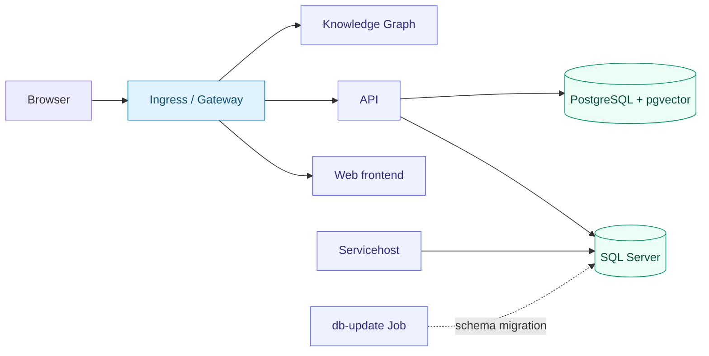

# MEF.DEV · Kubernetes

<p>
  
  
  
</p>

**Deploy and operate MEF.DEV with Helm.**

A complete installation guide for the web frontend, API, background services,
document service, SQL Server and PostgreSQL with pgvector. Choose your Ingress or
Gateway controller and configure each component through a single values file.

**[Start installation](#1-prepare-the-repository-and-namespace)** ·
**[Connect ingress](#networking)** ·
**[Configure applications](#application-configuration)** ·
**[Troubleshoot](#troubleshooting)**

---

## Guide map

| Install | Operate | Configure |
| :--- | :--- | :--- |
| [Requirements](#prerequisites) | [Update an application](#update-an-application) | [Application settings](#application-configuration) |
| [1. Repository & namespace](#1-prepare-the-repository-and-namespace) | [Run a database migration](#database-update) | [Values reference](#configuration) |
| [2. Values & Secrets](#2-configure-values-and-secrets) | [Back up & restore](#backup-and-restore) | [Storage & shared files](#storage-and-databases) |
| [3. Databases](#3-install-databases) | [Upgrade older charts](#upgrade-and-migration) | [Container images](#images) |
| [4. Initial migration](#4-run-the-database-migration) | [Uninstall applications](#uninstall-applications) | [Ingress & Gateway profiles](#networking) |
| [5. Applications](#5-install-applications) | [Troubleshooting](#troubleshooting) | [Optional Secret bindings](#optional-secret-bindings) |
| [6. Ingress, DNS & TLS](#networking) | | |

## Deployment model



```text
k8s/
├── README.md
└── helm/
    ├── charts/          # Component Helm charts
    └── values/          # One complete YAML file per component
        ├── api.yaml
        ├── apps.yaml
        ├── …
        ├── secrets/     # Plain Kubernetes Secret templates
        └── ingress/     # Ingress and Gateway profiles
```

| Convention | Where it is configured |
| :--- | :--- |
| Namespace | `mef-dev` in all installation and administration commands |
| One values file per component | `helm/values/<component>.yaml` |
| Separate credentials | Templates in `helm/values/secrets/`; local copies in `.local/secrets/` |
| Selectable routing | Profiles in `helm/values/ingress/` |
| Optional diagrams | Install `plantuml` when diagram rendering is needed |

**Installation order:** namespace → values & Secrets → shared PVCs → databases → migration → applications → routing.

> [!NOTE]
> Output blocks illustrate the expected result; they are not execution logs.
> IP addresses, revisions and durations depend on your cluster. Each step includes an
> **OK** condition to check before continuing.


<a id="prerequisites"></a>
## Before you begin

| Requirement | Prepare |
| :--- | :--- |
| Cluster | Linux Kubernetes **1.28+** for the application charts; check the chosen controller's requirements separately |
| Tools | Helm 3, kubectl and a kubeconfig for the intended cluster |
| Registry access | Docker Hub access from cluster nodes; the registry used by your selected controller |
| Persistent storage | An RWX-capable StorageClass for shared application files; database StorageClasses or existing PVCs |
| Public access | Your application domains, DNS records and a TLS certificate covering those domains |
| Load balancing | A LoadBalancer implementation, or the documented ClusterIP / port-forward option |
| Application setup | Database schema/data, signing keys when required, and initial user accounts |

Start with one replica per component. SQL Server needs at least **2 GiB** for its
process; allow additional capacity for the operating system, applications and routing
controller. Set resource requests and limits for your workload.

> [!IMPORTANT]
> The supplied SQL Server values select **Developer edition**, for non-production use.
> Choose the appropriate edition and licensing before a production deployment.
> Chart defaults use `ACCEPT_EULA: N`; installation values explicitly set it to `Y`.

The database charts deploy single instances. Plan backups and recovery separately;
`local-path` storage is tied to its node. Shared application files require storage
accessible to all participating Pods. See [storage and databases](#storage-and-databases).

---


## 1. Prepare the repository and namespace

```bash
git clone --branch dev https://github.com/mef-dev/k8s.git
cd k8s

export KUBECONFIG="$HOME/.kube/config"
export KUBE_CONTEXT="$(kubectl config current-context)"

kubectl --context "$KUBE_CONTEXT" get nodes
kubectl --context "$KUBE_CONTEXT" get storageclass
kubectl --context "$KUBE_CONTEXT" create namespace mef-dev --dry-run=client -o yaml | \
  kubectl --context "$KUBE_CONTEXT" apply -f -
```

Expected node state:

```text
NAME       STATUS   ROLES           AGE   VERSION
worker-1   Ready    <none>          10d   v1.35.0
```

**OK:** the selected context is your intended cluster and the nodes are `Ready`.
A default StorageClass must exist when `persistence.storageClass` is empty. Otherwise,
set an available class in each persistent component's values, or provide an `existingClaim`.

## 2. Configure values and Secrets

| Component | Purpose | Complete values |
| :--- | :--- | :--- |
| `storage` | Shared application PVCs | [storage.yaml](helm/values/storage.yaml) |
| `mssql` | SQL Server and persistent storage | [mssql.yaml](helm/values/mssql.yaml) |
| `pgvector` | PostgreSQL with the vector extension | [pgvector.yaml](helm/values/pgvector.yaml) |
| `db-update` | Explicit database migration Job | [db-update.yaml](helm/values/db-update.yaml) |
| `api` | API | [api.yaml](helm/values/api.yaml) |
| `apps` | Web frontend | [apps.yaml](helm/values/apps.yaml) |
| `servicehost` | Background tasks and integrations | [servicehost.yaml](helm/values/servicehost.yaml) |
| `knowledge-graph` | Documents and packages | [knowledge-graph.yaml](helm/values/knowledge-graph.yaml) |
| `plantuml` | Optional diagram renderer | [plantuml.yaml](helm/values/plantuml.yaml) |

> [!TIP]
> Edit the complete files above for your installation. Keep credentials in the separate
> [Secret templates](helm/values/secrets/) and choose routing settings from
> [ingress profiles](helm/values/ingress/).

Set storage classes, resource limits, domains, API URLs and integration settings.
Review migration settings before using an existing database. See [application configuration](#application-configuration).

Before applying resources, review these installation-specific settings:

| Setting | Edit |
| :--- | :--- |
| Shared storage | `storage.yaml` → `claims.<name>.storageClass` and `size`; RWX support required |
| Database storage | `persistence.storageClass`, capacity and any `existingClaim` |
| Frontend API address | `apps.yaml` → `config.data.config.json` → `apiUrl` |
| API authentication | `api.yaml` → `config.appsettings.AuthOptions` |
| Database access | Passwords and connection strings in the Secret files |
| Background work | Servicehost task definitions, activation lists and integration credentials |
| Public routing | Domain names, TLS Secret and the selected IngressClass / Gateway |

### Prepare credentials

Copy Secret templates into the ignored local directory:

```bash
mkdir -p .local/secrets
chmod 700 .local .local/secrets
cp -n helm/values/secrets/*.yaml .local/secrets/
chmod 600 .local/secrets/*.yaml
```

Replace every `REPLACE_*` marker in `.local/secrets/*.yaml`. Database passwords must
match those in the API/servicehost connection strings. The bootstrap password is independent: it creates a SQL login, not a frontend user.
Provision application users through your deployment's supported MEF account-provisioning
process; these charts do not define a default web administrator account.
Then apply the filled files:

```bash
kubectl --context "$KUBE_CONTEXT" --namespace mef-dev apply -f .local/secrets/
kubectl --context "$KUBE_CONTEXT" --namespace mef-dev get secret \
  mssql-auth pgvector-auth db-update-bootstrap api-secrets servicehost-secrets
```

Expected output:

```text
NAME                  TYPE     DATA   AGE
mssql-auth            Opaque   1      1m
pgvector-auth         Opaque   1      1m
db-update-bootstrap   Opaque   1      1m
api-secrets           Opaque   2      1m
servicehost-secrets   Opaque   2      1m
```

**OK:** all five Secrets exist with the required keys. This listing hides their contents;
Secret existence alone does not confirm a correct database password.

### Create shared application PVCs

Edit [helm/values/storage.yaml](helm/values/storage.yaml) and select your RWX-capable
StorageClass for `front`, `back` and `api-config`. An empty `storageClass` selects the
cluster default, which must support `ReadWriteMany`. Choose capacity for your files;
the supplied sizes are starting values. The ordinary k3s `local-path` provisioner
is not a multi-node RWX backend.

```bash
helm upgrade --install storage helm/charts/storage \
  --kube-context "$KUBE_CONTEXT" --namespace mef-dev \
  --values helm/values/storage.yaml

kubectl --context "$KUBE_CONTEXT" --namespace mef-dev get pvc front back api-config
```

| PVC | Default size | Access | Applications |
| :--- | :--- | :--- | :--- |
| `front` | 10 GiB | ReadWriteMany | API, Apps, Servicehost |
| `back` | 10 GiB | ReadWriteMany | Servicehost, Knowledge Graph |
| `api-config` | 1 GiB | ReadWriteMany | API |

**OK:** all three claims exist with the selected StorageClass. With immediate binding,
expect `Bound`; `WaitForFirstConsumer` claims may remain `Pending` until step 5 creates
the consuming Pods. The storage release deliberately omits `--wait` to allow this mode.
After installing the applications, all claims must be `Bound`.

If these named PVCs already belong to another release or are managed manually, set
`claims.<name>.create: false` for those claims in `storage.yaml`. The chart will not
adopt or modify them. All application PVC references must resolve in `mef-dev`.

## 3. Install databases

Run each Helm command successfully before continuing:

```bash
helm upgrade --install pgvector helm/charts/pgvector \
  --kube-context "$KUBE_CONTEXT" --namespace mef-dev \
  --values helm/values/pgvector.yaml --wait --timeout 10m

helm upgrade --install mssql helm/charts/mssql \
  --kube-context "$KUBE_CONTEXT" --namespace mef-dev \
  --values helm/values/mssql.yaml --wait --timeout 15m

kubectl --context "$KUBE_CONTEXT" --namespace mef-dev get pods mssql-0 pgvector-0
kubectl --context "$KUBE_CONTEXT" --namespace mef-dev get pvc
```

Expected Pod state:

```text
NAME         READY   STATUS    RESTARTS   AGE
mssql-0      1/1     Running   0          3m
pgvector-0   1/1     Running   0          4m
```

**OK:** both Pods are `1/1 Running` and their PVCs are `Bound`.
A `Pending` PVC requires fixing the StorageClass or volume provisioning before proceeding.

Check the vector extension:

```bash
kubectl --context "$KUBE_CONTEXT" --namespace mef-dev exec pgvector-0 -- \
  sh -ec 'psql -U "$POSTGRES_USER" -d "$POSTGRES_DB" -v ON_ERROR_STOP=1 -c "SELECT extname FROM pg_extension WHERE extname = '\''vector'\'';"'
```

Expected output:

```text
 extname
---------
 vector
(1 row)
```

**OK:** the target PostgreSQL database contains the `vector` extension.

## 4. Run the database migration

Review `helm/values/db-update.yaml`. The supplied file enables migration and creates
a new UCP database. For an existing database, set `database.createIfMissing: false`,
review the schema/filegroups and take a backup before running this command.

```bash
helm upgrade --install db-update helm/charts/db-update \
  --kube-context "$KUBE_CONTEXT" --namespace mef-dev \
  --values helm/values/db-update.yaml --wait --wait-for-jobs --timeout 35m

kubectl --context "$KUBE_CONTEXT" --namespace mef-dev get jobs \
  -l app.kubernetes.io/name=db-update
```

Expected result for `migration.runId: initial-2-2-6-21`:

```text
NAME                            COMPLETIONS   DURATION   AGE
db-update-initial-2-2-6-21        1/1           2m         3m
```

Some Kubernetes versions also show a `STATUS` column with `Complete`.
**OK:** the Job has `1/1` completions and Helm exits successfully. Stop if migration
fails; do not start background processing against an incomplete schema. The completed
Job is removed after its configured TTL. See [database update](#database-update).

Before continuing, confirm that the database contains the schema and application data
required for your deployment. See [database migration procedure](#database-update) for
existing databases and subsequent migrations.

## 5. Install applications

```bash
helm upgrade --install api helm/charts/api \
  --kube-context "$KUBE_CONTEXT" --namespace mef-dev \
  --values helm/values/api.yaml --wait --timeout 10m

helm upgrade --install servicehost helm/charts/servicehost \
  --kube-context "$KUBE_CONTEXT" --namespace mef-dev \
  --values helm/values/servicehost.yaml --wait --timeout 10m

helm upgrade --install knowledge-graph helm/charts/knowledge-graph \
  --kube-context "$KUBE_CONTEXT" --namespace mef-dev \
  --values helm/values/knowledge-graph.yaml --wait --timeout 10m

helm upgrade --install apps helm/charts/apps \
  --kube-context "$KUBE_CONTEXT" --namespace mef-dev \
  --values helm/values/apps.yaml --wait --timeout 10m
```

Optional PlantUML:

```bash
helm upgrade --install plantuml helm/charts/plantuml \
  --kube-context "$KUBE_CONTEXT" --namespace mef-dev \
  --values helm/values/plantuml.yaml --wait --timeout 10m
```

Each successful Helm install reports, for example:

```text
NAME: api
NAMESPACE: mef-dev
STATUS: deployed
REVISION: 1
```

### List the created objects

```bash
kubectl --context "$KUBE_CONTEXT" --namespace mef-dev get deployments,statefulsets
kubectl --context "$KUBE_CONTEXT" --namespace mef-dev get services
helm list --kube-context "$KUBE_CONTEXT" --namespace mef-dev
```

Expected workload state:

```text
NAME                              READY   UP-TO-DATE   AVAILABLE   AGE
deployment.apps/api           1/1     1            1           5m
deployment.apps/apps          1/1     1            1           4m
deployment.apps/knowledge-graph        1/1     1            1           5m
deployment.apps/servicehost    1/1     1            1           5m
deployment.apps/plantuml       1/1     1            1           4m

NAME                        READY   AGE
statefulset.apps/mssql      1/1     10m
statefulset.apps/pgvector   1/1     11m
```

PlantUML appears only if installed. These are workload names; Kubernetes assigns
Pod names automatically. The migration Job is shown separately in step 4.

Check storage after the application Pods have started:

```bash
kubectl --context "$KUBE_CONTEXT" --namespace mef-dev get pvc \
  front back api-config mssql pgvector
```

Expected claim state (StorageClass and volume names depend on your cluster):

```text
NAME         STATUS   CAPACITY   ACCESS MODES
front        Bound    10Gi       RWX
back         Bound    10Gi       RWX
api-config   Bound    1Gi        RWX
mssql        Bound    10Gi       RWO
pgvector     Bound    10Gi       RWO
```

**OK:** all five PVCs are `Bound`. There are no separate `api` or `servicehost` PVCs
in a fresh installation; these applications share `front` and reference the other
claims according to the [mount table](#storage-and-databases).


| Service | Type | Port |
|---|---|---:|
| `apps` | ClusterIP | 80 |
| `api` | ClusterIP | 5000 |
| `knowledge-graph` | ClusterIP | 80 |
| `servicehost` | ClusterIP | 7000 |
| `plantuml` | ClusterIP | 8080 |
| `mssql` | ClusterIP | 1433 |
| `pgvector` | ClusterIP | 5432 |

Database headless Services also appear. **OK:** long-running Pods are Ready, application
Helm releases have `deployed` status, and the migration completed. API readiness checks its HTTP liveness endpoint; servicehost readiness checks its TCP
listener. Check application access after connecting ingress.

### Health probes

| Component | Startup | Readiness | Liveness |
| :--- | :--- | :--- | :--- |
| API | HTTP `/api/v0/live`, port 5000 | HTTP `/api/v0/live` | Disabled |
| Apps | TCP 80 | HTTP `/` | Disabled |
| Knowledge Graph | HTTP `/`, port 80 | HTTP `/` | HTTP `/` |
| Servicehost | TCP 7000 | TCP 7000 | Disabled |
| SQL Server | TCP 1433 | Authenticated `SELECT 1` | Disabled |
| pgvector | TCP 5432 | `pg_isready` | Disabled |
| PlantUML | TCP 8080 | TCP 8080 | Disabled |
| db-update | — | — | —; completion is controlled by the Job |

Startup probes allow up to approximately five minutes, except Knowledge Graph, which allows
approximately 150 seconds. Knowledge Graph liveness uses a 20-second period, a five-second
timeout and three consecutive failures. PostgreSQL readiness has a five-second timeout.

A failed readiness probe removes a Pod from ready Service endpoints; it does not
restart the container. Startup and liveness failures can restart it. Empty
`livenessProbe: {}` leaves automatic hang detection disabled; a process exit is still
handled by the Pod restart policy. Enable additional liveness checks only with an
endpoint that measures the local process independently of external services.
API liveness responses and TCP checks do not verify login, background jobs or database
schema. `pg_isready` checks server acceptance, not credentials or the vector extension.

<a id="networking"></a>
## 6. Connect Ingress or Gateway

Choose one routing path for each application. All profiles are in
[`helm/values/ingress/`](helm/values/ingress/):

| Routing option | Controller setup | Application profiles |
| :--- | :--- | :--- |
| [Community ingress-nginx](#classic-ingress-nginx) | Helm installation below; legacy option | `classic/ingress-nginx/` |
| [NGINX Gateway Fabric](#nginx-gateway-fabric) | Helm + Gateway API | `gateway/nginx-gateway-fabric/` |
| [Envoy Gateway](#envoy-gateway) | Helm + Gateway API | `gateway/envoy-gateway/` |
| [Traefik Gateway](#traefik) | Helm + Gateway API | `gateway/traefik/` |
| [Traefik / HAProxy Ingress](#other-classic-controllers) | Use your existing controller | `classic/traefik/` or `classic/haproxy/` |

Application profiles contain settings to merge into the complete component values file.
Controller values are passed only to the controller chart. Files containing `apiVersion`
and `kind` are Kubernetes manifests; apply only the selected ones, not the entire directory.

### Classic ingress-nginx

Community ingress-nginx is a legacy option: maintenance ended in March 2026.
See the [upstream announcement](https://kubernetes.io/blog/2025/11/11/ingress-nginx-retirement/).
NGINX Gateway Fabric below is a separate project.

#### Install the controller

```bash
helm upgrade --install mef-ingress-nginx ingress-nginx \
  --repo https://kubernetes.github.io/ingress-nginx --version 4.15.1 \
  --kube-context "$KUBE_CONTEXT" --namespace mef-dev --create-namespace \
  -f helm/values/ingress/classic/ingress-nginx/controller-values.yaml \
  --wait --timeout 10m
```

Inspect the controller:

```bash
kubectl --context "$KUBE_CONTEXT" --namespace mef-dev get deployment mef-ingress-nginx-controller
kubectl --context "$KUBE_CONTEXT" --namespace mef-dev get service mef-ingress-nginx-controller
kubectl --context "$KUBE_CONTEXT" get ingressclass mef-ingress-nginx
```

Expected Deployment state:

```text
NAME                           READY   UP-TO-DATE   AVAILABLE   AGE
mef-ingress-nginx-controller    1/1     1            1           2m
```

Expected class:

```text
NAME                CONTROLLER                 PARAMETERS   AGE
mef-ingress-nginx   k8s.io/mef-ingress-nginx    <none>       2m
```

**OK:** the controller is available and its IngressClass exists. For LoadBalancer
access, the Service must also have an external IP/hostname. `<pending>` means the
load-balancer address has not been assigned; do not use it as a working endpoint.

The controller creates the non-default IngressClass `mef-ingress-nginx` and a
LoadBalancer Service. Your cluster must provide a load-balancer implementation.
For ClusterIP access, append the profile's `controller-local.yaml` and use the
[local access example](#local-access-without-a-loadbalancer). If using an existing controller instead, set the application
profile's `ingress.className` to its actual IngressClass.

#### Create TLS credentials

Use a certificate covering all application domains:

```bash
kubectl --context "$KUBE_CONTEXT" --namespace mef-dev create secret tls mef-tls \
  --cert=.local/tls.crt --key=.local/tls.key --dry-run=client -o yaml | \
  kubectl --context "$KUBE_CONTEXT" --namespace mef-dev apply -f -
```

Inspect the TLS object without showing its contents:

```bash
kubectl --context "$KUBE_CONTEXT" --namespace mef-dev get secret mef-tls
```

Expected output:

```text
NAME      TYPE                DATA   AGE
mef-tls   kubernetes.io/tls   2      1m
```

**OK:** the Secret is in the application namespace with certificate and private-key
entries. The certificate must cover the exact configured hostnames.

#### Configure and expose applications

Merge each `classic/ingress-nginx/<component>.yaml` profile into
`helm/values/<component>.yaml`. For API, the routing section is:

```yaml
networking:
  mode: ingress
ingress:
  className: mef-ingress-nginx
  annotations:
    nginx.ingress.kubernetes.io/ssl-redirect: "true"
    nginx.ingress.kubernetes.io/proxy-body-size: "20m"
    nginx.ingress.kubernetes.io/proxy-read-timeout: "300"
    nginx.ingress.kubernetes.io/proxy-send-timeout: "300"
  hosts:
    - host: api.example.com
      paths:
        - path: /
          pathType: Prefix
  tls:
    - secretName: mef-tls
      hosts:
        - api.example.com
```

Replace `api.example.com` with your API domain. Configure the other components in the
same way using their profiles. Update frontend API URLs and API authentication/CORS
settings for your domains. Then apply the complete values with Helm:

```bash
for component in api servicehost knowledge-graph apps; do
  helm upgrade --install "$component" "helm/charts/$component" \
    --kube-context "$KUBE_CONTEXT" --namespace mef-dev \
    -f "helm/values/$component.yaml" --wait --timeout 10m || break
done

kubectl --context "$KUBE_CONTEXT" --namespace mef-dev get svc mef-ingress-nginx-controller
kubectl --context "$KUBE_CONTEXT" --namespace mef-dev get ingress
```

Expected Ingress rows (documentation address shown):

```text
NAME       CLASS               HOSTS                 ADDRESS        PORTS    AGE
api        mef-ingress-nginx   api.example.com       203.0.113.10   80,443   1m
apps       mef-ingress-nginx   apps.example.com      203.0.113.10   80,443   1m
knowledge-graph  mef-ingress-nginx   knowledge-graph.example.com   203.0.113.10   80,443   1m
```

**OK:** the class, hostnames and target Services match your values. The ADDRESS is
populated from the controller's published Service; ClusterIP/port-forward setups
may not publish an external address.

Point your domain DNS records to the controller's external address. Repeat the same
Helm command after changing a component's routing settings. Install optional PlantUML
using its own values file and matching profile.

#### Other classic controllers

`classic/traefik/` and `classic/haproxy/` connect application Ingress objects to existing
controllers with classes `traefik` and `haproxy`. Replace those class names if necessary.
Traefik must have `providers.kubernetesIngress.enabled: true`; the Gateway-only Traefik
profile below disables that provider. Use annotations belonging to the chosen controller.

### Gateway API controllers

| Controller | Helm chart | Notes |
|---|---|---|
| NGINX Gateway Fabric | 2.6.7 | GatewayClass `mef-nginx` |
| Envoy Gateway | v1.9.2 | GatewayClass `mef-envoy` |
| Traefik | 41.7.1 / app v3.7.14 | GatewayClass `mef-traefik` |

These profiles use Gateway API v1.6.1 CRDs. Check controller compatibility before changing versions. Do not replace CRDs owned by another Helm release or use `--force-conflicts` blindly.
On a new cluster with no Gateway API CRDs, install the reviewed standard bundle first:

```bash
kubectl --context "$KUBE_CONTEXT" apply --server-side \
  -f https://github.com/kubernetes-sigs/gateway-api/releases/download/v1.6.1/standard-install.yaml
```

The following commands use `KUBECONFIG` and `KUBE_CONTEXT` from [step 1](#1-prepare-the-repository-and-namespace).
Application and controller releases use namespace `mef-dev`.
Controller examples use LoadBalancer for a normal installation. On k3s without a suitable external
load balancer, use the additional `controller-local.yaml` profile or the documented ClusterIP proxy.
ClusterIP access uses port-forward without reserving the host's ports 80/443.

#### NGINX Gateway Fabric

```bash
helm upgrade --install mef-ngf oci://ghcr.io/nginx/charts/nginx-gateway-fabric \
  --version 2.6.7 --kube-context "$KUBE_CONTEXT" --namespace mef-dev --create-namespace \
  -f helm/values/ingress/gateway/nginx-gateway-fabric/controller-values.yaml
# For a laptop append: -f helm/values/ingress/gateway/nginx-gateway-fabric/controller-local.yaml
```

The chart installs NGF-specific CRDs. The common Gateway API CRDs are a separate prerequisite.
[Upstream installation](https://docs.nginx.com/nginx-gateway-fabric/install/helm/).

#### Envoy Gateway

Install only Envoy-specific CRDs so the chart's bundled common Gateway API CRDs do not replace a
cluster-managed version:

```bash
mkdir -p .local/vendor
helm pull oci://docker.io/envoyproxy/gateway-helm --version v1.9.2 \
  --untar --untardir .local/vendor
kubectl --context "$KUBE_CONTEXT" apply --server-side \
  -f .local/vendor/gateway-helm/charts/crds/crds/generated/
helm upgrade --install mef-eg .local/vendor/gateway-helm --skip-crds --set crds.gatewayAPI.safeUpgradePolicy.enabled=false \
  --kube-context "$KUBE_CONTEXT" --namespace mef-dev --create-namespace \
  -f helm/values/ingress/gateway/envoy-gateway/controller-values.yaml
kubectl --context "$KUBE_CONTEXT" apply -f helm/values/ingress/gateway/envoy-gateway/gatewayclass.yaml
```

For a ClusterIP data-plane Service, apply `proxy-local.yaml` in the application namespace and add to
your copy of `gateway.yaml`:

```yaml
spec:
  infrastructure:
    parametersRef:
      group: gateway.envoyproxy.io
      kind: EnvoyProxy
      name: mef-local
```

The Envoy control-plane Service type is distinct from the generated Envoy data-plane Service.
[Upstream installation](https://gateway.envoyproxy.io/docs/tasks/quickstart/).

#### Traefik

```bash
helm repo add traefik https://traefik.github.io/charts
helm repo update traefik
helm upgrade --install mef-traefik traefik/traefik --version 41.7.1 \
  --kube-context "$KUBE_CONTEXT" --namespace mef-dev --create-namespace \
  -f helm/values/ingress/gateway/traefik/controller-values.yaml
# For a laptop append: -f helm/values/ingress/gateway/traefik/controller-local.yaml
```

If the Traefik CRDs are already managed by your distribution, inspect compatibility and use `--skip-crds`
to avoid replacing their ownership. Do not install a second controller using an existing default class.
The example uses explicit class `mef-traefik`. Traefik's default container entrypoints are 8000/8443,
so its Gateway listeners use those ports; its Service exposes client ports 80/443.
[Upstream chart](https://github.com/traefik/traefik-helm-chart).

### TLS, Gateway and application routes

Prepare a certificate covering all configured application hostnames (for example your actual replacements
for apps.example.com, api.example.com, etc.). Keep private keys in your secret manager/protected files:

```bash
kubectl --context "$KUBE_CONTEXT" --namespace mef-dev create secret tls mef-tls \
  --cert=.local/tls.crt --key=.local/tls.key --dry-run=client -o yaml | \
  kubectl --context "$KUBE_CONTEXT" --namespace mef-dev apply -f -
export GATEWAY_PROFILE=nginx-gateway-fabric  # or envoy-gateway / traefik
kubectl --context "$KUBE_CONTEXT" --namespace mef-dev apply \
  -f "helm/values/ingress/gateway/$GATEWAY_PROFILE/gateway.yaml"
kubectl --context "$KUBE_CONTEXT" --namespace mef-dev apply \
  -f "helm/values/ingress/gateway/$GATEWAY_PROFILE/redirect.yaml"
```

Use the same application domains in the component route values, `redirect.yaml` hostnames
and TLS certificate SANs. Update the frontend origin in any selected CORS policy or Middleware.
`redirect.yaml` attaches to the HTTP listener and redirects to HTTPS port 443. Application routes attach to the HTTPS listener. Merge the chosen route profile from
`helm/values/ingress/gateway/<profile>/<component>.yaml` into that component’s complete file in
`helm/values/`. Upgrade using the same file, for example:

```bash
helm upgrade --install api helm/charts/api --kube-context "$KUBE_CONTEXT" --namespace mef-dev \
  -f helm/values/api.yaml
```

The examples keep Gateway, routes, certificate and backend Services in the same namespace.
For a shared Gateway in another namespace, set `gateway.parentRefs[].namespace` and explicitly configure
its listener's `allowedRoutes`. Cross-namespace backend/Secret references additionally need suitable
ReferenceGrants; do not grant unrelated namespaces indiscriminate access.

### Controller-specific settings

- For NGF or Envoy standard HTTPRoute CORS, merge `gateway/common/cors.yaml` into the
  API routing settings. Set the exact allowed frontend origin.
- For Traefik CORS, enable `providers.kubernetesCRD.enabled`, apply
  `gateway/traefik/cors-middleware.yaml` in the application namespace, and merge
  `gateway/traefik/cors.yaml` into API values.
- Envoy also provides a `SecurityPolicy` example in `gateway/envoy-gateway/cors.yaml`.
  Select one CORS mechanism for a route.
- For an NGF body limit, apply `gateway/nginx-gateway-fabric/client-settings.yaml`.
  For Envoy, apply `gateway/envoy-gateway/body-limit.yaml`. Match the target HTTPRoute
  name and namespace. Request buffering requires memory proportional to concurrent uploads.
- Envoy's `gateway/envoy-gateway/https-http1.yaml` restricts the HTTPS listener to HTTP/1.1
  for body-limit enforcement. This excludes HTTP/2 and gRPC on that listener; use a
  separate listener for those protocols.

These paths are relative to `helm/values/ingress/`. Lists such as `gateway.rules`
replace previous lists: combine CORS, rewrites and headers into one rule list when needed.
Do not enable request buffering for streaming or WebSocket routes without accounting
for its effect on the application. Configure upload limits and timeouts for your workloads.

After changing application settings, repeat `helm upgrade --install` with its complete
values file. After changing controller values, repeat that controller's Helm command.
TLS Secrets and controller policy manifests are applied separately with kubectl.

For Gateway status:

```bash
kubectl --context "$KUBE_CONTEXT" --namespace mef-dev get gateway,httproute
kubectl --context "$KUBE_CONTEXT" --namespace mef-dev describe gateway mef-gateway
```

Routes need valid parent references and `Accepted` / `ResolvedRefs` conditions. Publish
DNS records pointing at the selected Gateway's external address.


Inspect the conditions after applying the Gateway and application routes:

```bash
kubectl --context "$KUBE_CONTEXT" --namespace mef-dev get gateway mef-gateway \
  -o jsonpath='{range .status.conditions[*]}{.type}={.status}{"\n"}{end}'
kubectl --context "$KUBE_CONTEXT" --namespace mef-dev get httproute api \
  -o jsonpath='{range .status.parents[*].conditions[*]}{.type}={.status}{"\n"}{end}'
```

Expected Gateway conditions include:

```text
Accepted=True
Programmed=True
```

Expected HTTPRoute conditions include:

```text
Accepted=True
ResolvedRefs=True
```

**OK:** the route attaches to the intended Gateway, all required references resolve,
and HTTPS access returns the expected application response.

| Result | What to check |
|---|---|
| Controller Service stays Pending | LoadBalancer provisioning or the chosen access method |
| TLS name/chain error | Hostname, certificate SANs, CA chain and `mef-tls` namespace |
| 404 from the controller | DNS/Host, IngressClass or Gateway parentRefs, path matches |
| 502/503 | Backend Service port, endpoints and Pod readiness |
| API liveness works but login fails | API/frontend URLs, authentication settings and database/account data |


### Local access without a LoadBalancer

For the community ingress-nginx controller, append
`-f helm/values/ingress/classic/ingress-nginx/controller-local.yaml`
to its Helm installation command. In one terminal, forward its HTTPS port:

```bash
kubectl --context "$KUBE_CONTEXT" --namespace mef-dev port-forward \
  service/mef-ingress-nginx-controller 8443:443
```

Expected output:

```text
Forwarding from 127.0.0.1:8443 -> 443
```

In another terminal, use the API hostname from your certificate and routing values:

```bash
export API_HOST="api.example.com"
curl --silent --show-error --fail \
  --resolve "$API_HOST:8443:127.0.0.1" \
  --cacert .local/ca.crt \
  --output /dev/null --write-out 'HTTP %{http_code}\n' \
  "https://$API_HOST:8443/api/v0/live"
```

Use `.local/ca.crt` for your CA certificate, or omit `--cacert` when the certificate
is trusted by the system. **OK:** the command prints `HTTP 200`. Keep port-forward
running while using this endpoint. For Gateway controllers, forward port 443 of the
selected data-plane Service instead; the control-plane Service is not the application endpoint.

### Open the applications

Replace these example domains with those configured in values and DNS:

| URL | Application |
|---|---|
| `https://apps.example.com` | Web frontend |
| `https://api.example.com/api/v0/live` | API liveness endpoint |
| `https://knowledge-graph.example.com` | Documents/packages |
| `https://plantuml.example.com` | Optional diagrams |

```bash
export API_HOST="api.example.com"
export APPS_HOST="apps.example.com"
curl --silent --show-error --fail --output /dev/null \
  --write-out 'HTTP %{http_code}\n' "https://$API_HOST/api/v0/live"
curl --silent --show-error --fail --output /dev/null \
  --write-out 'HTTP %{http_code}\n' "https://$APPS_HOST/"
```

Expected result from each command:

```text
HTTP 200
```

For a private CA, add `--cacert /path/to/ca.crt`. **OK:** TLS is trusted, API liveness
returns 200 and the frontend opens. Login and enabled business integrations additionally
require their configured accounts, database data and external services. Servicehost
is a background service; its root URL is not a required public web page.

---

## Operations

Use the same complete values file for each update. Database migrations are a separate, explicit operation.

### Update an application

Change the component's complete values file, then run the same command again.
To fetch a newly published `latest` image when the tag string is unchanged, restart
the Deployment after the Helm upgrade:

```bash
helm upgrade --install api helm/charts/api \
  --kube-context "$KUBE_CONTEXT" --namespace mef-dev \
  --values helm/values/api.yaml --wait --timeout 10m
kubectl --context "$KUBE_CONTEXT" --namespace mef-dev rollout restart deployment/api
kubectl --context "$KUBE_CONTEXT" --namespace mef-dev rollout status deployment/api
```

Expected result:

```text
deployment "api" successfully rolled out
```

`image.pullPolicy: Always` pulls the tag when a container starts. An unchanged
`latest` tag by itself does not trigger Pod replacement. Restart only the intended
application; coordinate database restarts separately.

**OK:** the Helm revision increases, the Deployment rollout completes and API access
still works. For a schema update, use the separate [migration procedure](#database-update).

<a id="database-update"></a>
### Database migration procedure


1. Install SQL Server and verify connection with the migration account. Set `database.createIfMissing: true` only for intentional creation of a new database; it defaults to false. The local example opts in.
2. Back up the database and prove the restore procedure. Stop/quiesce application writers as required.
3. Choose the image tag/application version and review the schema change. The local profile's reduced
   partition counts are intended only for a new disposable database, not for changing existing partition layouts.
4. Execute one migration at a time. Choose a new `runId` only for an intentional execution.

```bash
helm upgrade --install db-update helm/charts/db-update --kube-context "$KUBE_CONTEXT" \
  --namespace mef-dev -f helm/values/db-update.yaml \
  --wait --wait-for-jobs --timeout 35m
kubectl --context "$KUBE_CONTEXT" --namespace mef-dev get jobs -l app.kubernetes.io/name=db-update
```

The default Secret is `mssql-auth/password`; configure a dedicated migration account for production.
`database.trustServerCertificate` controls self-signed SQL TLS acceptance. Use a trusted SQL certificate
and disable this option for a properly configured production connection.

`backoffLimit: 0` prevents automatic retries of a partially applied update. A failed Job requires inspection
of its failure and database state before any new run. A timeout may also leave partially applied changes.
Do not roll back only the Helm release and assume the schema was rolled back.

A successful Job is necessary but not sufficient: verify expected tables/procedures and release metadata,
then API health, login, queries and task execution.
Changing values on an existing Job can encounter immutable fields. Use a new runId after review, and
retain the previous execution evidence. TTL is 24 hours by default; export necessary diagnostic evidence first.
After Kubernetes deletes the Job, repeating `helm upgrade --install db-update` can execute the migration
again even with the same `runId`. Run this release only for an intentional database migration;
do not include it in routine application upgrades.

<a id="backup-and-restore"></a>
### Backup and restore

1. Establish the application/image/schema version and a maintenance plan for writers.
2. Take database-native backups: SQL Server `BACKUP DATABASE`, PostgreSQL `pg_dump`/the backup method
   appropriate to your recovery objective. Store connection credentials in protected files or Secrets.
3. Back up shared package/config files and required signing/encryption keys. Preserve ownership and permissions.
4. Transfer backups off the Kubernetes node and record checksums, timestamps and image versions.
5. Restore into an isolated namespace with fresh PVCs. Verify SQL queries, the vector extension,
   API authentication, task processing and documentation/file access.
6. Only after successful validation define production retention, scheduling and recovery procedures.

A copied live database data directory is not automatically a consistent backup. The local-path storage
class does not provide off-node redundancy. Helm release history and retained PVCs do not replace backups.

Uninstall applications with explicit namespace/release names. Do not append namespace deletion, PVC deletion
or filesystem `rm` commands to the normal uninstall procedure. Data destruction must be an intentional,
separate operation after backup verification.

### Uninstall applications

```bash
helm uninstall apps api knowledge-graph servicehost \
  --kube-context "$KUBE_CONTEXT" --namespace mef-dev
# If installed:
helm uninstall plantuml --kube-context "$KUBE_CONTEXT" --namespace mef-dev
```

Expected output includes `release "api" uninstalled` for each removed release.
Databases, retained PVCs and Secrets remain separate. Back up data before removing
SQL/PostgreSQL releases; deleting a namespace also deletes its Secrets and PVCs.
See [storage](#storage-and-databases) and [backup/restore](#backup-and-restore).

If a step does not reach its expected state, see [troubleshooting](#troubleshooting).

<a id="upgrade-and-migration"></a>
### Upgrading from older charts

Start in a new namespace and validate against a disposable/restored database copy. This is a breaking
values update, not a promise of an in-place upgrade from every historical repository state.

| Previous input | New input |
|---|---|
| `api` public chart / `ucpapi` private chart | Public chart and release name `api` |
| Layered values | One complete file per component in `helm/values/` |
| `httpPort` | `containerPort` |
| `ingress.enabled` | `networking.mode: ingress` with explicit class/hosts |
| nginx-only annotations/snippets | Standard route filters or controller-specific policy; inspect semantic differences |
| `persistence.accessMode` | `persistence.accessModes` list |
| Private `appsConfig`, `ucpapiConfig`, `appsettings` wrappers | Explicit `config.data` files or an existing Secret/ConfigMap |
| Generated plaintext credential values | Pre-created Secrets referenced from `env`, `envFrom` or mounted files |
| `{{ .Values.env.APP_VERSION }}` | Explicit `image.tag` |
| hostPath and fixed node names | StorageClass/existing PVC and optional administrator scheduling constraints |

Before changing a running release:

1. Record installed chart/image versions, PVC/PV bindings, selectors and Service ports.
2. Back up the database and shared files; prove restore into a separate namespace.
3. Build clean 2.0 values. Do not use `--reuse-values` with legacy inputs.
4. Render and inspect differences. Check immutable StatefulSet fields and Deployment selectors.
5. Test with restored data, route traffic only after application checks pass, and retain the old deployment
   and backup until the migration is accepted.

The new StatefulSet `serviceName`, persistence layout and image entrypoints may differ from old releases.
Helm cannot update every immutable field. Do not work around a failed upgrade by deleting PVCs.
Recreate workloads only as part of a reviewed migration with explicit existing-claim references.

For later compatible updates, use the component's documented Helm command with
`--namespace mef-dev` and its complete values file. Verify rollout,
SQL access, route status, TLS, authentication and file access. `helm rollback` can roll back Kubernetes
resources; it does not undo database migrations or mutations of persistent files.

---

## Configuration reference

Use these sections when adapting the installation to your environment.

<a id="application-configuration"></a>
### Application configuration

Edit only `helm/values/<component>.yaml` for an installation, then repeat its
`helm upgrade --install` command. API and servicehost contain the complete
`config.appsettings` structure; Helm generates appsettings.json from that object.
Frontend URLs and login-provider settings are in `apps.yaml`, under
`config.data.config.json`. The frontend nginx configuration is `config.data.nginx.conf`.

#### API

Set `AuthOptions.Issuer`, `Audience`, `Domain`, token lifetimes and authentication options
under `config.appsettings`. Replace example domains with your own domains.
Configure EntityGenerator, Opendatabot and provider endpoints only when those services
are available. OAuth providers also need their public client ID, redirect URI and
Secret-bound credentials. Database connections come from `api-secrets`.

Credentials are bound under `env`, for example:

```yaml
env:
  AuthOptions__Google__ClientSecret:
    valueFrom:
      secretKeyRef:
        name: api-integrations
        key: googleClientSecret
```

Create the referenced Secret separately in the application namespace. Enabling Google
also requires `config.appsettings.AuthOptions.GoogleAuth: true` and the provider settings
under `AuthOptions.Google`. Apply the corresponding provider flag/settings for other OAuth providers.

#### Servicehost

`config.appsettings` contains Diagnostic, Serilog, SystemAssociations, HttpClients,
HealthCheck and the complete Tasks definitions. Set the correct database associations,
Kafka topics/endpoints, HTTP service URLs and mail settings for your installation.

`config.disabledTaskProducers` and `config.disabledBackgroundServices` disable named tasks.
Remove only the names of tasks you want to activate. For workflow processing, activate
`WorkflowEvent` in both lists and the required `any` producer. Configure Kafka, its database
procedures and the workflow authorization Secret before enabling it.

SMTP processing also needs sender settings, templates, credentials and `SendMail: true`.
For task keys containing dots, use a complete file supplied by `config.existingSecret`
if the cluster does not support the corresponding environment variable names.

#### Logging

API defaults keep console logging with `config.disabledLogSinks: [1, 2, 3, 4]`.
Servicehost defaults disable sinks 0 and 3. Remove indexes to enable required sinks;
configure their endpoints, credentials, permissions and retention first.

Disabled sinks are removed from the rendered list. Environment variable indexes must
match the resulting active list. The logging bindings below assume all sinks enabled
with `config.disabledLogSinks: []`: API SQL sinks are indexes 2/3, Elasticsearch is 4,
and the servicehost SMTP sink is 3.

#### Optional Secret bindings

<details>
<summary>Expand integration environment variables and Secret keys</summary>

Add only the bindings for integrations you activate:

| Environment key under `env` | Secret | Key |
|---|---|---|
| `AuthOptions__EntraId__ClientSecret` | `api-integrations` | `entraClientSecret` |
| `AuthOptions__Google__ClientSecret` | `api-integrations` | `googleClientSecret` |
| `AuthOptions__IdGovUa__ClientSecret` | `api-integrations` | `idGovUaClientSecret` |
| `AuthOptions__IdGovUa__PKeyPassword` | `api-integrations` | `idGovUaPKeyPassword` |
| `AuthOptions__Linkedin__ClientSecret` | `api-integrations` | `linkedinClientSecret` |
| `Serilog__WriteTo__2__Args__configureSink__0__Args__connectionString` | `api-integrations` | `serilogMssqlConn` |
| `Serilog__WriteTo__3__Args__configureSink__0__Args__connectionString` | `api-integrations` | `node1Connection` |
| `Serilog__WriteTo__4__Args__configureLogger__WriteTo__0__Args__connectionGlobalHeaders` | `api-integrations` | `serilogElasticHeader` |
| `OpendatabotApiKey` | `api-integrations` | `opendatabotApiKey` |
| `Serilog__WriteTo__3__Args__configureLogger__WriteTo__0__Args__configure__0__Args__userName` | `servicehost-integrations` | `smtpUser` |
| `Serilog__WriteTo__3__Args__configureLogger__WriteTo__0__Args__configure__0__Args__password` | `servicehost-integrations` | `smtpPassword` |
| `Tasks__HttpClients__0__Headers__Authorization` | `servicehost-integrations` | `workflowServiceAuth` |
| `workflowServiceAuth` | `servicehost-integrations` | `workflowServiceAuth` |

</details>

#### Mounted configuration and files

`config.data.appsettings.json` overrides the structured object as a complete file.
`config.existingSecret` or `config.existingConfigMap` mounts an external complete file.
These whole-file modes bypass the disabled-task/log-sink lists: the supplied file must
itself disable unwanted integrations. Keep credentials out of ConfigMaps and public values.

For signing keys, mount the relevant Secret keys as `/app/public_key.xml` and
`/app/private_key.xml`. Encrypted API settings use `/app/appsettings.json.aes`.
Kerberos configuration uses `/etc/krb5.conf` and `env.KRB5_CONFIG: /etc/krb5.conf`.
Add Secret volumes and read-only subPath mounts in the component's `volumes` and
`volumeMounts` lists. Create the Secrets before upgrading the release.

API shared files use `/storage/ProdK8S`; Apps sees the same files under `/storage`.
Servicehost uses `/storage/ProdK8S`, `/files/config` and `/mefdev_storage/packages`
as shown in the [storage mapping](#storage-and-databases).
Objects merge recursively but YAML lists replace previous lists: combine the complete
set of mounts or environment entries when editing them.

For SQL Server, set `env.MSSQL_AGENT_ENABLED` and `env.MSSQL_COLLATION` in `mssql.yaml`
when needed. Select collation before initializing the data directory; changing an
environment variable does not convert existing databases or columns.

<a id="configuration"></a>
### Values reference

The seven long-running component charts are independent and accept complete `values.yaml` defaults. Only modern Kubernetes APIs
are emitted. The eighth chart, `db-update`, has a separate opt-in Job contract described in
[database update](#database-update). Unknown top-level keys fail schema validation to expose mistakes in legacy values.

<details>
<summary>Expand the complete values reference</summary>

| Setting | Meaning |
|---|---|
| `image.repository`, `image.tag`, `image.pullPolicy` | Image repository, tag and pull policy |
| `imagePullSecrets` | Kubernetes Secret-name list; never credentials |
| `containerPort`, `service.port` | Container listener versus Service port; routes target the Service port |
| `env` | Flat environment map: scalar value or `{valueFrom: {secretKeyRef: ...}}` |
| `envFrom` | Standard Kubernetes `secretRef`/`configMapRef` list |
| `config.appsettings` (API/servicehost) | Complete structured settings; see [application configuration](#application-configuration) |
| `config.disabledLogSinks` / disabled task lists | Explicit activation controls; full definitions remain in values |
| `config.data` | Filename to string mapping; non-secret ConfigMap content, including JSON strings |
| `config.mounts` | List of `{key, mountPath}` file mounts |
| `config.existingSecret` / `existingConfigMap` | Mutually exclusive external source, in the release namespace |
| `volumes`, `volumeMounts` | Native Kubernetes structures for shared PVCs and Secret files |
| `persistence.*` | Chart-owned retained PVC or `existingClaim`, storage class, access modes and mount path |
| `resources` | Requests and limits; set these before enabling HPA |
| `startupProbe`, `readinessProbe`, `livenessProbe` | Native probe objects; `{}` disables a probe |
| `networking.mode` | Exactly one of `none`, `ingress`, `gateway`; database charts allow only `none` |
| `gateway.parentRefs`, `hostnames`, `rules` | Route attachment, DNS names and matches/filters; backend Service is generated |
| `ingress.className`, `hosts`, `tls`, `annotations` | Standard Ingress with explicit controller class |

</details>

Helm does not evaluate values as templates. Use explicit version strings, paths and names; values containing
`{{ ... }}` are not an interpolation API. Nested .NET settings use environment names such as
`AuthOptions__Google__ClientSecret`. List values are replaced, not merged, by Helm.

Changes to chart-owned ConfigMaps change a Pod-template checksum. With external Secrets/ConfigMaps,
restart the corresponding Deployment after a change: file mounts use `subPath`, and environment variables
are fixed at container startup. With these Secret references, credential values stay out of Helm release values.

The frontend nginx configuration is editable in `helm/values/apps.yaml`, under
`config.data.nginx.conf`. Configure headers and any API-dependent behavior there;
frontend API URLs belong in `config.data.config.json`.

Defaults retain public resource names/selector conventions, including the chart name `api`. The values
interface is a breaking 2.0 change. Database upgrades need additional care even when the resource names match.

For the complete application fields and integration settings, read [application configuration](#application-configuration).

<a id="storage-and-databases"></a>
### Storage and databases

SQL Server and PostgreSQL are single replicas backed by a retained PVC. A separate headless Service
provides StatefulSet identity; the ordinary ClusterIP Service is the client endpoint. Database HPA and
replica counts above one are rejected. Increasing replicas would not create a replicated database.

`persistence.storageClass: ""` uses the cluster default; `"-"` requests no storage class.
This choice applies when creating a PVC. For an existing release, preserve the original
StorageClass value in your complete values file; changing a named class to `""` also
attempts an immutable PVC change. Use a separate volume/data migration when changing storage.
`persistence.existingClaim` references a pre-created claim without managing its lifecycle.
`persistence.retain: true` annotates a chart-created PVC with `helm.sh/resource-policy: keep`.
Do not assume `helm uninstall` is a backup, or that a PVC is safe after deleting its namespace.

The application charts use the same named PVCs, created once by the `storage` release:

| PVC | Application | Mount path | Directory within PVC |
| :--- | :--- | :--- | :--- |
| `front` | API | `/storage/ProdK8S` | Entire volume |
| `front` | Apps | `/storage` | Entire volume |
| `front` | Servicehost | `/storage/ProdK8S` | Entire volume |
| `front` | Servicehost | `/files/config` | `config` (`subPath`) |
| `back` | Servicehost | `/mefdev_storage/packages` | Entire volume |
| `back` | Knowledge Graph | `/usr/share/nginx/html/packages` | Entire volume |
| `api-config` | API | `/config` | Entire volume |
| `mssql` | SQL Server | `/var/opt/mssql` | Separate database volume, 10 GiB by default |
| `pgvector` | PostgreSQL | `/var/lib/postgresql/data` | Separate database volume, 10 GiB by default |

API `/storage/ProdK8S/report.pdf`, Apps `/storage/report.pdf` and Servicehost
`/storage/ProdK8S/report.pdf` are the **same file on `front`**. A package written by
Servicehost to `/mefdev_storage/packages/demo.json` appears in Knowledge Graph at
`/usr/share/nginx/html/packages/demo.json`, served as `/packages/demo.json`.
Servicehost `/files/config` uses `front/config`; it is not the `api-config` PVC.

Application `persistence.enabled` is false because `volumes` and `volumeMounts` reference
the shared claims explicitly. Do not enable separate per-application PVCs for these
mount paths. PlantUML and db-update do not need file PVCs. SQL Server and PostgreSQL
retain their own `ReadWriteOnce` database volumes; never share their data directories.

Servicehost's init container creates `config` and `logs` on `front` before its `subPath`
mount is used. API and Servicehost use `fsGroup: 1000`; the non-root API and init container
need write access as UID 1655 with supplementary GID 1000 for the supplied API image. The storage backend must support these permissions or
be provisioned with equivalent access. This matters with NFS root squash and CSI drivers
that do not manage filesystem ownership. Shared volumes must support `ReadWriteMany`
when consumers run on different nodes; a node-local disk does not provide that capability.

`pgvector/pgvector:pg16` is used to preserve the PostgreSQL major version of the source configuration.
Do not point a different PostgreSQL major version at an old data directory.
The chart bootstraps `CREATE EXTENSION IF NOT EXISTS vector` only for a new database directory.

`digitalbss/mssql` is the selected MEF SQL image. Do not substitute a generic SQL image and assume it
contains the same application schema. The chart bypasses the image's built-in seed command and runs `/opt/mssql/bin/sqlservr` directly. Use the separate db-update Job for schema creation; the original image bootstrap has incomplete SQLCMD variables and an embedded default login password. Changing
`MSSQL_SA_PASSWORD` in a Secret does not necessarily rotate an existing database login; verify the SQL-side
password change separately. The same applies to PostgreSQL's initialization password variables.

`db-update` runs only after explicit opt-in; see [database update](#database-update).
`storage-control` is not included. Shared storage must be managed explicitly. Process readiness does not establish that application data and background workflows are ready.


#### Existing installations and shared storage

For a new installation, install the `storage` release before application releases as
shown in step 2. The supplied application values already contain all shared mounts.
No additional mount snippets are required.

For an existing installation with separate API/Servicehost PVCs, back up the source
volumes, stop file writers and copy the intended data into `front`, `back` and `api-config`
before upgrading. Map files to the paths in the table above and resolve conflicting
filenames explicitly. Helm changes mounts but does not copy or merge stored files.
Keep the original PVCs until application access and data have been verified.

Knowledge Graph mounts `back` with `readOnly: false`: its image startup command changes
the mounted directory's mode. The backend must allow this operation. Mount the whole
`back` volume at `/usr/share/nginx/html/packages`; do not add a `packages` subdirectory
inside `back`. Servicehost's `DocIntegrationUrl` must use your Knowledge Graph domain
with the `/packages` suffix.

Shared PVCs have `helm.sh/resource-policy: keep` by default. Keep the `storage` release
when uninstalling applications. Deleting the namespace can still delete PVCs; take
backups independently and check your PV reclaim policy.

<a id="images"></a>
### Container images

| Component | Image |
|---|---|
| apps | `digitalbss/apps:latest` |
| api | `digitalbss/api:latest` |
| knowledge-graph | `digitalbss/knowledge-graph:latest` |
| servicehost | `digitalbss/servicehost:latest` |
| mssql | `digitalbss/mssql:latest` |
| db-update | `digitalbss/db-update:latest` |
| plantuml | `plantuml/plantuml-server:latest` |
| pgvector | `pgvector/pgvector:pg16` |

Images use tags with `image.pullPolicy: Always`. The pgvector repository does not
publish a `latest` tag; `pg16` selects PostgreSQL 16. Do not change the PostgreSQL
major version on an existing data directory without a database migration.
`applicationVersion` in db-update is the schema/application version passed to the
migration, independent of the image tag. Set it for the database release you intend to apply.

---

<a id="troubleshooting"></a>
## Troubleshooting

Use your explicit kubeconfig/context and application namespace on each command.

| Symptom | Check |
|---|---|
| `ImagePullBackOff` | Repository/tag, Docker Hub limits, node egress and any pull Secret |
| API cannot write `/storage/ProdK8S` | Mounted PVC, CSI fsGroup support, actual image UID and filesystem permissions |
| Frontend nginx cannot resolve `ucpapi` | Use the chart's mounted nginx.conf; public Service is `api` |
| `ConfigService::ConfigSection is null` | Task-host `Tasks` object and required `HttpClients` configuration |
| API Ready but SQL errors | Actual database/schema and credentials; a successful probe does not verify business operations |
| PVC Pending | StorageClass, access mode, capacity and WaitForFirstConsumer scheduling |
| PostgreSQL lacks vector extension | Initialization runs once; create the extension in the correct existing database |
| SQL auth fails after Secret change | Database password and bootstrap env password are distinct after initialization |
| Gateway rejects route | `Accepted`, `ResolvedRefs`, parent name/namespace/sectionName, allowedRoutes and feature support |
| HTTPS fails | Certificate SAN, Secret namespace/type, HTTPS listener and client trust |
| Browser login fails while curl works | CORS preflight, allowed origin, credentials and cookie domain/SameSite/Secure |
| External config updated but app unchanged | Restart Pods using external ConfigMap/Secret file subPath or env values |

Collect scoped events, Pod status and application errors. Redact passwords, connection strings, bearer
tokens and private key material before sharing logs. Do not publish `helm get values` or Secret dumps.
